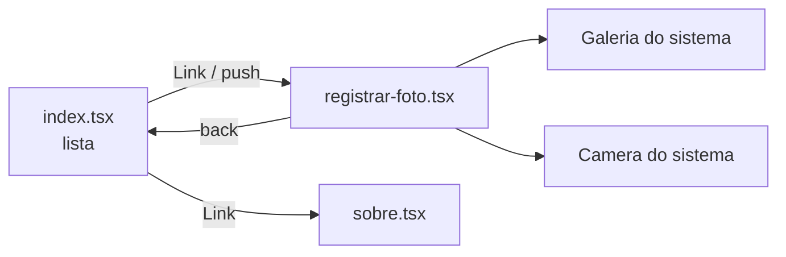
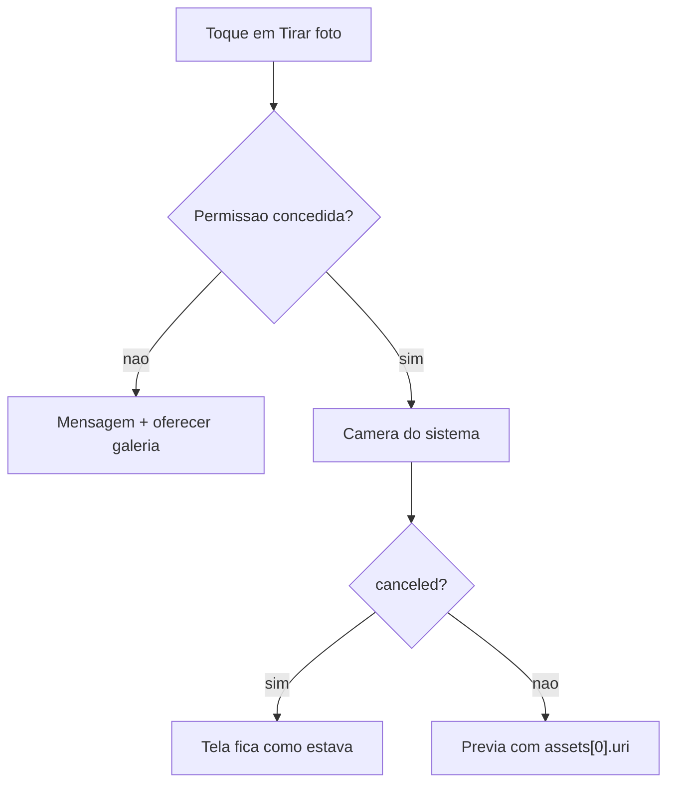
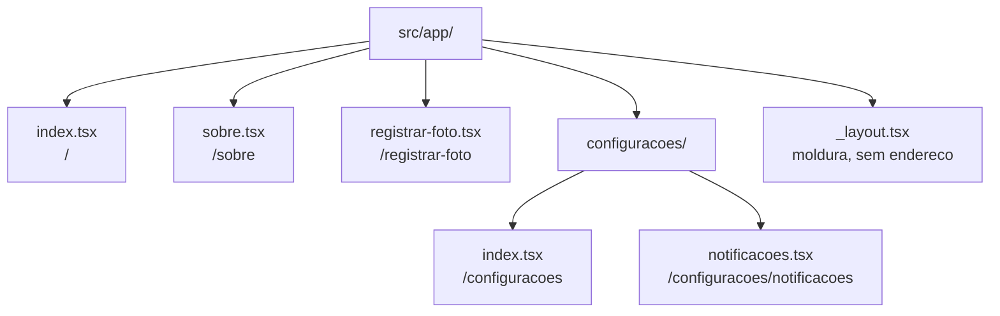
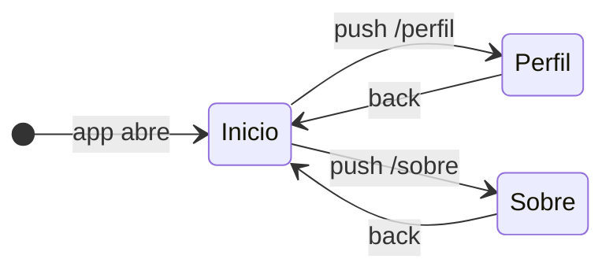

<!--
Slides em Markdown compatíveis com Marp.
Para exportar:  npx @marp-team/marp-cli@latest presentation.md -o aula6.pdf
Os blocos de comentário HTML são notas do apresentador (não aparecem no slide).
Materiais irmãos: lesson-plan.md · student-notes.md · exercises.md · practice.md (equivalência Pet).

>>> PARA PROJETAR EM SALA, USE `presentation.html` (reveal.js). <<<
Este arquivo .md é a fonte em Markdown, para leitura rápida no editor e para
quem preferir Marp. O Marp NÃO renderiza blocos ```mermaid nativamente — os
diagramas aparecem como código. A versão HTML renderiza tudo e ainda tem
modo apresentador, visão geral e navegação por teclado.

Para gerar o PDF com a identidade visual preservada (a partir da pasta 2026.2.DM):
    node tools/slides-to-pdf.mjs "aulas/aula-06-image-picker-expo-router/presentation.html"
-->

<!-- _class: capa -->

# Desenvolvimento Mobile

### Aula 6 — Galeria, câmera e telas de verdade

expo-image-picker · Expo Router · CESAR School 2026.2

<!--
Antes de começar: a metade de navegação roda em simulador; a câmera NÃO
(o iOS Simulator não tem câmera).

Expo Go em iPhone físico agora exige login: `npx expo login`, mesma conta
no CLI e no app. Resolver isso AGORA — a aula começa pela câmera e pela galeria.

Dizer qual arquivo cada grupo segue: exercises.md (Hábito) ou practice.md (Pet).
-->

---

## Agenda

1. **`expo-image-picker`**: a galeria
2. **`expo-image-picker`**: a câmera e as permissões
3. ✋ Checkpoint 1 · ☕ Intervalo
4. **Expo Router**: roteamento por arquivos
5. `_layout.tsx` e `Stack`: a pilha de telas
6. `Link` e `router`: andar pela pilha
7. ✋ Checkpoint 2
8. Levando para o seu projeto
9. Hands-on guiado · Atividade aplicada

---

## Ao final da aula você deve conseguir

1. Escolher foto da galeria e ler `{ canceled, assets }` corretamente
2. Tirar foto com a câmera do sistema tratando os **três estados** da permissão
3. Decidir entre `expo-image-picker` e `expo-camera`
4. Prever o **endereço** de uma tela só olhando o caminho do arquivo
5. Montar o `_layout.tsx` com `Stack` e dar **título** a cada tela
6. Navegar com `Link` e com `router.push` / `router.back` — e saber **qual** usar
7. Explicar a navegação como uma **pilha**
8. Migrar um projeto de `App.tsx` para o Expo Router

---

## O que entra hoje

- **`expo-image-picker`** — galeria e câmera do sistema
- **A base do Expo Router** — arquivos viram telas, `_layout` com `Stack`, `Link` e `router`

> Hoje cada tela **se vira sozinha**. Levar informação de uma tela para outra é o assunto da **próxima aula**.

<!--
Nota curta de escopo para a turma. A lista detalhada do que fica de fora
está no lesson-plan.md — não projetar.
-->

---

## Duas ferramentas, um app com cara de app



### Fotos que o usuário **já tem** e telas com **endereço**.

<!--
Começamos pelas fotos (galeria e câmera do sistema) e depois damos
endereço às telas.

Leitura do diagrama: a tela inicial leva por Link ou push à tela de
registrar foto e à tela "sobre"; a tela de foto volta com back, e de
dentro dela o app abre a galeria ou a câmera DO SISTEMA, pelo
expo-image-picker.
-->

---

<!-- _class: lead -->

# Parte 1

## `expo-image-picker`: a galeria

---

## Cozinhar × pedir no balcão

**`expo-image-picker`** abre a **tela do sistema** para o usuário escolher uma foto da galeria ou tirar uma com a câmera — e **devolve o arquivo** para o seu app.

- 🍳 **`expo-camera` (Aula 5) é montar a cozinha:** fogão, panela, botão, layout — tudo seu
- 🛎️ **`expo-image-picker` é pedir no balcão:** o sistema entrega o prato pronto, do jeito dele

---

## O que isso significa na prática

| | `expo-camera` (Aula 5) | `expo-image-picker` (hoje) |
|---|---|---|
| A interface | **sua** — `CameraView` na tela | **do sistema** — abre por cima |
| Galeria | não tem | tem |
| Recorte | você construiria | `allowsEditing` |
| Flash, zoom, sobreposição | controle total | nenhum |
| Código | gate + `CameraView` + referência | **uma chamada `await`** |

> Se a câmera **é** a funcionalidade → `expo-camera`. Se a foto é **um anexo** → `expo-image-picker`.

<!--
Exemplos de anexo: foto de perfil, foto do hábito, foto do pet.
Exemplos de câmera-funcionalidade: scanner, filtro, câmera contínua.
-->

---

## O contrato de três tempos, de novo

```bash
npx expo install expo-image-picker
```

| Pacote | Pedir | Ler | Parar |
|---|---|---|---|
| picker — galeria | **não precisa** | `launchImageLibraryAsync()` | — |
| picker — câmera | `requestCameraPermissionsAsync()` | `launchCameraAsync()` | — |

### É um **copo d'água**, não uma torneira: não existe `remove()`.

<!--
Voltar à tabela da Aula 5 na lousa e acrescentar as duas linhas.
npx expo install, não npm install — regra da Aula 5.
-->

---

## Por que a galeria não pede permissão

- Quem mostra as fotos é o **sistema**, não o seu app
- O seu app só recebe a foto que o usuário **escolheu**
- O usuário já decidiu — **foto por foto**

### A permissão acompanha o risco (Aula 5).

---

## Abrir a galeria

```tsx
import * as ImagePicker from 'expo-image-picker';

async function escolherDaGaleria() {
  const resultado = await ImagePicker.launchImageLibraryAsync({
    mediaTypes: ['images'],
    allowsEditing: true,
    aspect: [4, 3],
    quality: 0.7,
  });

  if (resultado.canceled) return;
  setFotoUri(resultado.assets[0].uri);
}
```

<!--
Chamado de dentro do onPress de um Pressable. Demonstrar ao vivo,
projetando a tela do aparelho.
-->

---

## As opções

| Opção | Valores | Default | O que faz |
|---|---|---|---|
| `mediaTypes` | `['images']` | `'images'` | o que aparece para escolher |
| `allowsEditing` | booleano | `false` | abre o **recorte** depois da escolha |
| `aspect` | `[largura, altura]` | — | proporção do recorte — **só Android** |
| `quality` | **0 a 1** | `1` | compressão do JPEG |
| `allowsMultipleSelection` | booleano | `false` | escolher várias |
| `selectionLimit` | número | `0` = máximo | teto da seleção |
| `base64` | booleano | `false` | **não peça sem precisar** |

---

## O resultado: `canceled` e `assets`

```ts
// usuário escolheu
{ canceled: false, assets: [{ uri, width, height, fileName, fileSize, mimeType, type }] }
// usuário desistiu
{ canceled: true, assets: null }
```

- **Cancelar não é erro.** Não cai em `catch`. É resultado **normal**
- **`assets` é sempre uma lista** — mesmo com uma foto só. Por isso `assets[0]`
- Depois do `if (resultado.canceled) return;`, o TypeScript **sabe** que `assets` não é `null`

<!--
Demo de 20 s: tirar o if e ver o erro do TypeScript aparecer em assets[0].
Narrowing ao vivo.
-->

---

## Zumbis do picker

| O tutorial que você vai achar | O que compila hoje |
|---|---|
| `mediaTypes: ImagePicker.MediaTypeOptions.Images` | `mediaTypes: ['images']` — **deprecado** |
| `if (!result.cancelled)` — dois "l" | **`result.canceled`** — um "l" |
| `setImage(result.uri)` | **`result.assets[0].uri`** |
| `Permissions.askAsync(Permissions.CAMERA_ROLL)` | cada pacote traz as suas funções |
| `requestCameraRollPermissionsAsync()` | `requestMediaLibraryPermissionsAsync()` |

---

<!-- _class: lead -->

## O pior dos cinco é o `cancelled`.

### Em JavaScript sem tipagem, `result.cancelled` é `undefined` — **falso** — e o código segue como se o usuário tivesse escolhido. **O TypeScript pega; o tutorial em JS, não.**

---

## Recorte: cada plataforma do seu jeito

| | Android | iOS |
|---|---|---|
| `allowsEditing` | recorta **e gira** | só recorta |
| `aspect: [4, 3]` | respeitado | **ignorado** — recorte sempre **quadrado** |

### A opção existe, compila, e faz coisas diferentes de cada lado.

Mesma lição do `timeInterval` da Aula 5: **declare** — não prometa "4:3" a quem usa iPhone.

---

## Seleção múltipla

```tsx
const resultado = await ImagePicker.launchImageLibraryAsync({
  mediaTypes: ['images'],
  allowsMultipleSelection: true,
  selectionLimit: 5,
});
if (!resultado.canceled) setFotos(resultado.assets);
```

- `allowsMultipleSelection` **desliga** o `allowsEditing` — não dá para recortar cinco de uma vez
- O resultado já é uma **lista** → direto para uma `FlatList` (Aula 4)

---

## Exibir — e onde está o arquivo

```tsx
import { Image } from 'expo-image';

<Image source={{ uri: fotoUri }} style={estilos.previa} contentFit="cover" transition={300} />
```

- **Nada novo:** o `expo-image` da Aula 5 — `contentFit` explícito, **import conferido**
- O `uri` aponta para uma **cópia no cache do app**
- Igual à foto do `takePictureAsync`: **não é permanente**

<!--
A pergunta que vai aparecer: "e como eu guardo essa foto de verdade?"
→ "ótima pergunta, e não é o assunto de hoje."
-->

---

<!-- _class: lead -->

# Parte 2

## A câmera e as permissões

---

## `launchCameraAsync`: mesma chamada, outra fonte

```tsx
async function tirarFoto() {
  const permissao = await ImagePicker.requestCameraPermissionsAsync();
  if (!permissao.granted) {
    setFalha(permissao.canAskAgain ? 'camera-negada' : 'camera-bloqueada');
    return;
  }

  const resultado = await ImagePicker.launchCameraAsync({
    mediaTypes: ['images'],
    allowsEditing: true,
    aspect: [4, 3],
    quality: 0.7,
  });

  if (resultado.canceled) return;
  setFotoUri(resultado.assets[0].uri);
}
```

<!--
Fazer a turma APONTAR cada tempo do contrato no código: pedir, tratar o
"não", ler. Mesmas opções e mesmo resultado da galeria — a diferença é uma
só: a câmera sempre pede permissão.
-->

---

## O caminho da foto



<!--
Leitura do diagrama: o toque leva ao pedido de permissão; se for negada, a
tela explica e oferece a galeria; se for concedida, abre a câmera do
sistema; se o usuário cancelar, nada muda; se escolher, a prévia aparece
com o uri do primeiro asset.
-->

---

## Os três estados da permissão

| Estado | O que a tela faz |
|---|---|
| `granted` | abre a câmera |
| `!granted` e `canAskAgain: true` | explica, deixa pedir de novo — e **oferece a galeria** |
| `!granted` e `canAskAgain: false` | o diálogo **não volta**: explica o caminho nas **Configurações** do aparelho |

> **Sempre existe um caminho:** a galeria não precisa de permissão.

<!--
Regra da Aula 5: estados de falha são MENSAGENS DIFERENTES na tela.
Insistir com o mesmo botão quando canAskAgain é false é o comportamento errado.

Mensagem sugerida: "A câmera foi bloqueada. Para liberar, abra Ajustes →
[nome do app] → Câmera. Enquanto isso, escolha uma foto da galeria."
-->

---

## As duas formas de perguntar

| Forma | Câmera | Galeria |
|---|---|---|
| chamada direta, no `onPress` | `requestCameraPermissionsAsync()` | `requestMediaLibraryPermissionsAsync()` |
| o par `[estado, pedir]`, no topo | `useCameraPermissions()` | `useMediaLibraryPermissions()` |

### Para o picker, a **chamada direta** é a natural.

A permissão só importa **no momento do toque** — a tela não muda de forma por causa dela.

<!--
O par [estado, pedir] fazia sentido no CameraView, porque a tela inteira
dependia da permissão. Aqui não.
-->

---

## ⚠️ A documentação discorda dela mesma

- O **texto** do `expo-image-picker`: *"No permissions request is necessary for launching the image library."*
- O **exemplo oficial**, logo abaixo: pede `requestMediaLibraryPermissionsAsync()` antes

### As duas coisas são verdade em contextos diferentes.

- o picker **do sistema** não precisa
- a permissão de biblioteca é para quem vai **ler a galeria inteira** por conta própria

> A aula segue o texto. E a lição é maior que a regra: **leia documentação com desconfiança**.

---

## O config plugin

```json
{
  "expo": {
    "plugins": [
      [
        "expo-image-picker",
        {
          "photosPermission": "Usamos suas fotos para você anexar a imagem do seu hábito.",
          "cameraPermission": "Usamos a câmera para você registrar a foto do seu hábito.",
          "microphonePermission": false
        }
      ]
    ]
  }
}
```

- Escreva o **porquê** — o usuário lê antes de decidir
- **`microphonePermission: false`**: por padrão o pacote pede microfone no Android (por causa de vídeo)

<!--
Frase da Aula 5: no Expo Go não faz diferença visível; na build de verdade,
faz. Escrevam agora.
-->

---

## Simulador, emulador e aparelho

| Onde | Galeria | Câmera |
|---|---|---|
| iOS Simulator | ✅ — arraste imagens do Mac para dentro | ❌ **não tem câmera** |
| Android Emulator | ✅ | ✅ câmera virtual (cena 3D) |
| Aparelho físico | ✅ | ✅ |

### Galeria em qualquer lugar; **câmera em aparelho físico**.

---

## Citado, não ensinado

| Recurso | O que é | Por que não hoje |
|---|---|---|
| `mediaTypes: ['videos']` | escolher ou gravar vídeo | outro arquivo, outra permissão (microfone) |
| `getPendingResultAsync()` | recupera a foto quando o Android **mata o app** com a câmera aberta | caso raro, de aparelho com pouca memória |
| salvar na galeria | outro pacote | não está no programa |

<!--
Uma frase cada, e seguir.
-->

---

## ✋ Checkpoint 1 — picker

1. Foto de perfil: `expo-camera` ou `expo-image-picker`? E um leitor de QR code?
2. Por que a galeria não pede permissão e a câmera pede?
3. O usuário tocou em "Cancelar". O que vem em `resultado`? Cai no `catch`?
4. `if (!result.cancelled) setImage(result.uri)` — quantos problemas?
5. Pedi `aspect: [4, 3]` e no iPhone veio quadrado. É bug?

<!--
60 s em duplas, 2–3 respostas em voz alta. Não avançar sem isso.
Na 1, voltar à cozinha × balcão. Na 3, escrever os dois objetos de
resultado lado a lado. Na 4: dois problemas — canceled e assets[0].uri.
-->

---

<!-- _class: lead -->

## ☕ Intervalo — 10 min

---

<!-- _class: lead -->

# Parte 3

## Roteamento por arquivos: a pasta é o mapa

---

<!-- _class: lead -->

## Na aula passada, o voltar do Android **fechou o app inteiro**.

### Hoje o app ganha telas de verdade — com endereço, pilha e um voltar que volta.

<!--
Gancho: na Aula 5, para mostrar a câmera, vocês esconderam a lista com um
if e um useState. Funcionou — e o botão de voltar do Android fechou o app.

Perguntar quem percebeu isso testando. Normalmente alguém percebeu.
-->

---

## Um app de verdade tem várias telas

- Até agora: **um componente só**, que trocava o que mostrava com um `if`
- Um app de verdade: o usuário **anda** — entra, volta, entra em outra
- Esse andar tem regras que o sistema **já conhece**:
  - gesto de voltar no iPhone
  - botão de voltar no Android
  - título no topo de cada tela

### Você não quer reimplementar nenhuma delas.

<!--
A virada conceitual da segunda metade: até aqui a foto vive numa tela só.
Agora o app ganha várias telas, e a tela de foto vira uma delas.
-->

---

## O que é o Expo Router

**Cada arquivo dentro de `src/app/` vira uma tela** — e o caminho do arquivo **é** o endereço da tela.

- 🏢 **O prédio e a placa da porta:** a pasta é a planta; cada arquivo é uma sala; o nome está na porta
- Para mandar alguém a uma sala, você não descreve o caminho — diz o número: `/sobre`
- Quem já fez web: é o `sobre.html` que vira `/sobre`. E o mesmo app roda na web

### Vocês já usam o Router desde a Aula 3 — sem saber.


---

## A regra de conversão

| Arquivo | Endereço (`href`) |
|---|---|
| `src/app/index.tsx` | `/` |
| `src/app/sobre.tsx` | `/sobre` |
| `src/app/registrar-foto.tsx` | `/registrar-foto` |
| `src/app/configuracoes/index.tsx` | `/configuracoes` |
| `src/app/configuracoes/notificacoes.tsx` | `/configuracoes/notificacoes` |
| `src/app/_layout.tsx` | **nenhum** — é moldura, não tela |

<!--
Na lousa, fazer a turma completar as três últimas linhas ANTES de mostrar.

O truque: ler o caminho do arquivo em voz alta, tirando "src/app" e ".tsx".
É literalmente a regra.
-->

---

## A pasta, desenhada



<!--
Leitura do diagrama: cada arquivo aparece com o endereço que ganha; a
subpasta configuracoes/ acrescenta um nível ao endereço, e o _layout.tsx é
o único que não vira tela.
-->

---

## Três regras que saem da tabela

1. **`index.tsx` é a tela padrão da pasta** — em `src/app/`, é a primeira tela do app
2. **Pasta vira pedaço do endereço** — subpasta = mais um `/`
3. **Arquivo que começa com `_` não é tela** — o `_layout.tsx`

> Nome de arquivo vira URL: **minúsculas e hífen** — `registrar-foto.tsx`, nunca `RegistrarFoto.tsx`.

<!--
No Android/Linux maiúscula importa. /RegistrarFoto e /registrar-foto são
endereços diferentes.
-->

---

## Uma tela é só um componente num lugar especial

```tsx
// src/app/sobre.tsx
import { StyleSheet, Text, View } from 'react-native';

export default function TelaSobre() {
  return (
    <View style={estilos.tela}>
      <Text>Rastreador de Micro-hábitos — versão da Aula 6.</Text>
    </View>
  );
}

const estilos = StyleSheet.create({
  tela: { flex: 1, padding: 24, justifyContent: 'center' },
});
```


<!--
É assim que o Router acha o componente da tela. Sem export default, ele
avisa que a rota não tem componente e a tela não abre.
-->

---

## O erro nº 1: componente dentro de `src/app/`

- **Tudo** em `src/app/` é tratado como rota
- `CardHabito.tsx` lá dentro vira uma tela `/CardHabito` — que ninguém pediu
- O resto mora **fora**: `src/components/`, `src/types/`, `src/services/`, `src/screens/`

> O próprio template avisa, no `npm run reset-project`:
> *"Put all your application code in /src, only screens and layout files should be in /src/app."*

<!--
É exatamente a estrutura que os repositórios de vocês já têm: src/components,
src/screens, src/types. Só falta o src/app.
-->

---

## Zumbi: `app/` × `src/app/`

| O que valia no passado | O que vale hoje |
|---|---|
| As rotas ficavam em `app/`, na raiz do projeto | Desde o **SDK 55**, o template cria **`src/app/`** |
| — | Se existirem as duas, **só `src/app/` é usada** |

- `app/` na raiz **ainda funciona** — mas não é mais recomendado!
- **Não misture:** com as duas pastas, a de fora é **ignorada em silêncio**

### Leia o terminal: `Using src/app as the root directory for Expo Router.`

<!--
Essa linha resolve metade dos "eu editei e não mudou nada".
-->

---

## Quem liga o Router

Nas aulas anteriores: `index.ts` com `registerRootComponent(App)`.

Com o Router, quem começa o app é o próprio Router:

```json
{ "main": "expo-router/entry" }
```

### Não existe mais `App.tsx`. O papel dele foi dividido em dois:

- a **moldura** → `src/app/_layout.tsx`
- a **primeira tela** → `src/app/index.tsx`

<!--
Voltamos a isso na Parte 6, quando migrarmos o projeto de vocês.
-->

---

<!-- _class: lead -->

# Parte 4

## `_layout.tsx` e `Stack`: a pilha de telas

---

## O que é um layout

O `_layout.tsx` **envolve** as telas da pasta e decide **como** se anda entre elas.

- 🖼️ **A moldura do quadro:** as telas são os quadros que você troca; o layout é a moldura que fica
- O cabeçalho com título e voltar **é da moldura**, não do quadro
- Hoje a moldura é sempre um **`Stack`** — pilha

<!--
Existem outros tipos de moldura. Não são o assunto de hoje — se perguntarem,
"ótima pergunta, e não é o assunto de hoje".
-->

---

## O layout mínimo

```tsx
// src/app/_layout.tsx
import { Stack } from 'expo-router';

export default function LayoutRaiz() {
  return <Stack />;
}
```

### É exatamente o arquivo que o `reset-project` gera.

Só com isso: cabeçalho, botão de voltar, gesto do iOS e voltar do Android.

<!--
Abrir o projeto de alguém da turma e mostrar o arquivo. Está lá desde a Aula 3.
-->

---

<!-- _class: lead -->

## A pilha de pratos

### Cada tela nova é um prato **colocado em cima** (`push`). Voltar é **tirar o de cima** (`back`).

<!--
Desenhar na lousa antes de mostrar mais código. É o modelo mental que
sustenta todo o resto.
-->

---

## A pilha, desenhada



<!--
Leitura do diagrama: o app abre na tela inicial; cada push coloca uma tela
nova por cima, e cada back tira a de cima e revela de novo a inicial, no
mesmo estado em que ficou.
-->

---

## "No mesmo estado em que ficou"

<div class="colunas">
<div>

### A tela de **baixo**

- **não** é recriada quando você volta
- rolou a lista até o meio? continua no meio

</div>
<div>

### A tela de **cima**

- sai da pilha e é **destruída**
- o `useState` dela **some**

</div>
</div>

> Escolheu uma foto em `/registrar-foto` e voltou? **A foto se foi.** Guardem isso.

<!--
Demonstrar ao vivo com uma lista longa: rolar, entrar, voltar.
A segunda coluna é o gancho do fim da aula.
-->

---

## Configurar as telas

```tsx
// src/app/_layout.tsx
import { Stack } from 'expo-router';

export default function LayoutRaiz() {
  return (
    <Stack screenOptions={{ headerTintColor: '#f26522' }}>
      <Stack.Screen name="index" options={{ title: 'Meus hábitos' }} />
      <Stack.Screen name="registrar-foto" options={{ title: 'Foto do hábito' }} />
      <Stack.Screen name="sobre" options={{ title: 'Sobre o app' }} />
    </Stack>
  );
}
```

---

## As três regras do `Stack.Screen`

1. **`name` é o nome do arquivo sem extensão** — `name="registrar-foto"` → `registrar-foto.tsx`
2. **`screenOptions` vale para todas; `options` vale para uma** — a de uma tela vence
3. **Listar não é obrigatório** — arquivo já é rota. Você lista para **configurar**, não para **registrar**

<!--
Errou o name? O Router avisa no console que não achou a rota, e a opção
simplesmente não é aplicada. Mostrar o aviso ao vivo, se der tempo.

Existe uma segunda forma — Stack.Screen dentro da própria tela. Faz sentido
quando o título depende de um dado da tela, que é assunto da próxima aula.
Citar e seguir.
-->

---

## Expo Navigation - Stack

| Opção | Para quê |
|---|---|
| `title` | texto do cabeçalho |
| `headerShown` | `false` esconde o cabeçalho |
| `headerTintColor` | cor do título e do voltar |
| `headerStyle` | `{ backgroundColor }` do cabeçalho |
| `headerBackTitle` | texto ao lado da seta, no iOS |


<!--
A pergunta que vai aparecer: "e aquela barra de abas embaixo, como no
Instagram?" → "ótima pergunta, e não é o assunto de hoje."
-->

---

<!-- _class: lead -->

# Parte 5

## `Link` e `router`: andar pela pilha

---

## `Link`: o caminho declarado

```tsx
import { Link } from 'expo-router';

<Link href="/sobre" style={estilos.link}>
  Sobre o app
</Link>

<Link href="/registrar-foto" asChild>
  <Pressable style={estilos.botao}>
    <Text style={estilos.textoBotao}>Registrar com foto</Text>
  </Pressable>
</Link>
```

- `Link` é um **`Text` que navega**
- **`asChild`**: o `Link` passa o toque para o **seu** `Pressable` (Aula 4)

---

## `href` começa com `/`

- `href="/sobre"` → endereço **absoluto**
- `href="sobre"` → endereço **relativo** à tela atual — numa subpasta, leva a **outro lugar**

### Utilize **sempre com barra**.

---

## `router`: navegar depois de uma ação

```tsx
import { useRouter } from 'expo-router';

export default function TelaInicial() {
  const router = useRouter();
  // ...
  <Pressable onPress={() => router.push('/registrar-foto')}>...</Pressable>
}
```

| Função | Na pilha |
|---|---|
| `router.push('/rota')` | **empilha** |
| `router.back()` | **desempilha** — o mesmo que o voltar |
| `router.canGoBack()` | existe tela embaixo? |
| `router.replace('/rota')` | **troca** o topo, sem deixar a anterior *(citar)* |

<!--
useRouter() é chamado no topo do componente, sem condicional — a mesma
regra do useState e do useCameraPermissions da Aula 5. Mesma forma; a
diferença é que devolve UM OBJETO, não um par.

replace em 30 s: com push o voltar retorna; com replace a anterior sumiu.
Mostrar uma vez, não exercitar.
-->

---

## `Link` ou `router.push`?

### A navegação acontece porque o usuário tocou **num link** — ou **depois que algo terminou**?

| Situação | Use |
|---|---|
| "Toque em *Sobre* leva para a tela Sobre" | **`Link`** — destino fixo, escrito na tela |
| "Depois que a foto foi escolhida, volta" | **`router.back()`**, depois do `await` |

> **`Link` no JSX; `router` dentro de função.**

---

## O TypeScript conhece as suas rotas

O template vem com `"experiments": { "typedRoutes": true }`. Depois do primeiro `npx expo start`, o Router **gera os tipos** das rotas.

```tsx
<Link href="/novaFoto">...</Link>   // o arquivo se chama registrar-foto.tsx
```

```text
Type '"/novaFoto"' is not assignable to type ...
Did you mean '"/registrar-foto"'?
```

### `href` errado é pego **no editor**, antes de rodar.

<!--
Demo ao vivo. Rodar npx expo start uma vez ANTES da aula para os tipos
existirem. Se renomear um arquivo, os tipos só se atualizam no próximo
expo start.
-->

---

## Duas plataformas, um voltar

| | Voltar |
|---|---|
| **iOS** | seta no cabeçalho + **gesto de arrastar da borda esquerda** |
| **Android** | seta no cabeçalho + **botão/gesto de voltar do sistema** |

### Os dois chamam o mesmo `back`. Você não escreve nada.


---

## Zumbis da navegação

| O que valia no passado | O que vale hoje |
|---|---|
| `NavigationContainer` + `createNativeStackNavigator()` no `App.tsx` | `<Stack />` no `_layout.tsx` |
| `navigation.navigate('Sobre')` — **nome** da tela | `router.push('/sobre')` — **endereço** |
| `import ... from '@react-navigation/native'` no app | importar de **`expo-router`** (SDK 56+) |
| "`router.navigate` volta se a tela já existe" | desde o SDK 52, **`navigate` empilha** — use `push` |
| "Expo Router v4 / v5" | o pacote segue o SDK: `expo-router@57` |

<!--
Por que tanto tutorial assim: o Expo Router é construído POR CIMA do React
Navigation. Os tutoriais de React Navigation continuam certos para o React
Navigation — mas vocês não usam a API dele diretamente.
-->

---

<!-- _class: lead -->

## Hoje cada tela **se vira sozinha**.

### Abrir "o hábito que eu toquei" ou levar a foto para a lista exige **levar informação de uma tela para outra**. É a próxima aula.

<!--
Dizer em voz alta. Se insistirem: "ótima pergunta, e é a próxima aula."
Não mostrar código.
-->

---

## ✋ Checkpoint 2 — rotas e pilha

1. Qual o endereço de `src/app/configuracoes/index.tsx`? E de `src/app/_layout.tsx`?
2. Coloquei o `CardHabito.tsx` em `src/app/`. O que acontece, e onde ele deveria estar?
3. Fiz `push('/registrar-foto')` e depois `back()`. A lista da tela inicial é recriada? E o `useState` da tela de foto?
4. Botão "Sobre": `Link` ou `router.push`? E o "Concluir", que só volta **depois** da foto escolhida?
5. O tutorial diz `navigation.navigate('Sobre')`. Como fica no nosso projeto?

<!--
Mesmo formato do Checkpoint 1.
Se travar: pilha de pratos de novo na lousa, com nomes de tela.
-->

---

<!-- _class: lead -->

# Parte 6

## Levando para o seu projeto: de `App.tsx` para `src/app/`

<!--
Os dois repositórios começaram no blank-typescript e abrem pelo App.tsx.
Fazer a migração junto com a turma, no projeto de um grupo, projetando.
-->

---

## A migração — parte 1

```bash
npx expo install expo-router react-native-safe-area-context react-native-screens expo-linking expo-constants expo-status-bar
npx expo install expo-image-picker
```

1. **Ponto de entrada** no `package.json`: `"main": "expo-router/entry"`
2. **`scheme`** no `app.json` — ex.: `"scheme": "habittracker"`
3. O `npx expo install` **já adiciona** `"expo-router"` em `plugins` — **confira, não duplique**

---

## A migração — parte 2

4. **Moldura:** `src/app/_layout.tsx` com `<Stack />`
5. **A tela atual vira a rota inicial** — sem mover código:

```tsx
// src/app/index.tsx
export { default } from '../screens/tela-habitos';
```

6. **Apagar** `App.tsx` e `index.ts`
7. **Reiniciar limpando o cache:** `npx expo start --clear`

### Conferir: `Using src/app as the root directory for Expo Router.`

<!--
A tela continua morando em src/screens/; a rota só APONTA para ela. É a
regra de "em src/app, só telas e layouts" aplicada.
-->

---

## O que costuma dar errado na migração

| Sintoma | Causa |
|---|---|
| o app abre o `App.tsx` antigo, ou reclama que ele sumiu | `"main"` não foi trocado |
| uma tela aparece duas vezes, ou uma rota estranha surge | componente **dentro** de `src/app/` *e* em `src/screens/` |
| "editei e não mudou" | faltou `--clear`, ou existe `app/` **e** `src/app/` |
| `"expo-router"` duas vezes em `plugins` | adicionado à mão depois do `expo install` |

---

## Hands-on guiado — 30 min

| # | Exercício | Tempo |
|---|---|---|
| 1 | Complete: o botão "Escolher da galeria" | 7 min |
| 2 | Caça ao erro: o picker do tutorial de 2022 | 6 min |
| 5 | Associação: qual arquivo, qual endereço | 4 min |
| 6 | Complete: o `_layout.tsx` com três telas | 5 min |
| 7 | Caça ao erro: a navegação do tutorial | 6 min |

**Para casa:** 3 (seleção múltipla em `FlatList`) e 4 (câmera com os três estados — aparelho físico).

Hábito → `exercises.md` · Pet → `practice.md`

<!--
Circular com a lista curta do que olhar: componente dentro de src/app,
name do Stack.Screen com extensão ou maiúscula, href sem barra,
if (resultado.canceled) ausente, import do Image errado.

Corrigir NA HORA, não no fim. O objetivo é acurácia, não criatividade.
-->

---

## Atividade aplicada — "O app com mais de uma tela"

Migrar o projeto para o Expo Router e entregar **três rotas estáticas**:

- **`/`** — a lista que já existe desde a Aula 4
- **`/registrar-foto`** — galeria **ou** câmera, com prévia em `expo-image`
- **`/sobre`** — informações do app

Navegação por `Link` **e** por `router`.

<!--
Conectar com a abertura: o app da Aula 5 trocava de "tela" com um if e
fechava inteiro no voltar do Android. O da Aula 6 tem endereços, pilha e
voltar que volta.
-->

---

## O que se avalia

1. Em `src/app/` **só** há telas e o `_layout.tsx`
2. O `_layout.tsx` dá **título a todas as telas**
3. `Link` onde o destino é fixo; `router` **depois** de uma ação — e o grupo sabe explicar
4. O picker trata **cancelar** e os **três estados** da câmera, e sempre oferece a galeria
5. **Nenhum zumbi:** `['images']`, `canceled`, `assets[0].uri`, nada de `@react-navigation/*`
6. O README **declara a limitação**: a foto escolhida não volta para a lista

<!--
Repetir em voz alta: é isso que será corrigido.
-->

---

<!-- _class: lead -->

## Hoje vocês têm três telas, e elas **não conversam**.

### A foto ficou presa na tela onde foi escolhida. Na Aula 7, **as telas começam a conversar**.

<!--
Fechar exatamente assim, palavra por palavra:

"Hoje vocês têm três telas, e elas não conversam. A foto ficou presa na
tela onde foi escolhida, e tocar num hábito ainda não abre aquele hábito.
Isso não é defeito do código de vocês — é a peça que falta. Na Aula 7, as
telas começam a conversar."
-->

---

## Atalhos desta apresentação

| Tecla | Ação |
|---|---|
| `→` / espaço · `←` | avançar · voltar |
| `S` | modo apresentador (notas + cronômetro) |
| `F` | tela cheia |
| `O` ou `Esc` | visão geral dos slides |
| `B` ou `.` | tela preta |
| `?` | todos os atalhos |

<p class="rodape-fonte">Dados conferidos em 06/10/2026 · Expo SDK 57 · fontes em <code>lesson-plan.md</code> e <code>student-notes.md</code></p>
