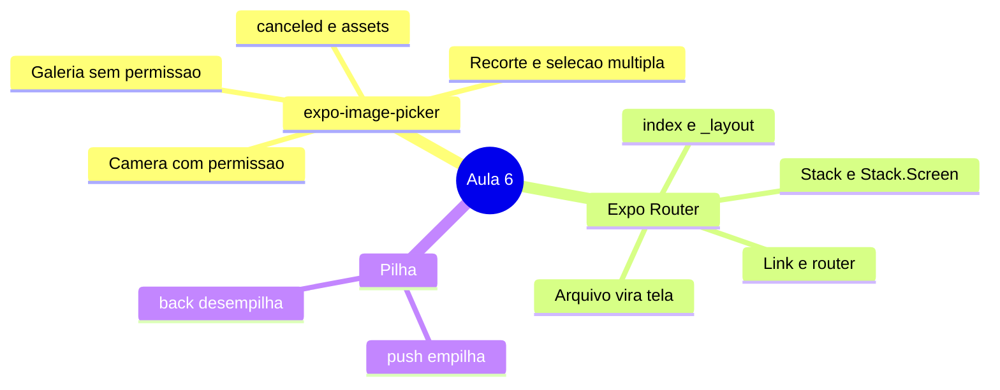
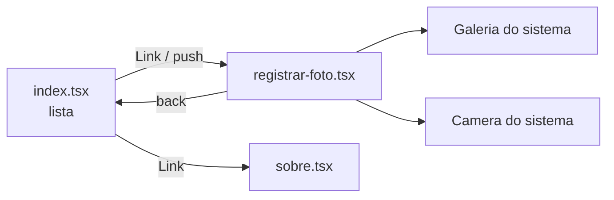
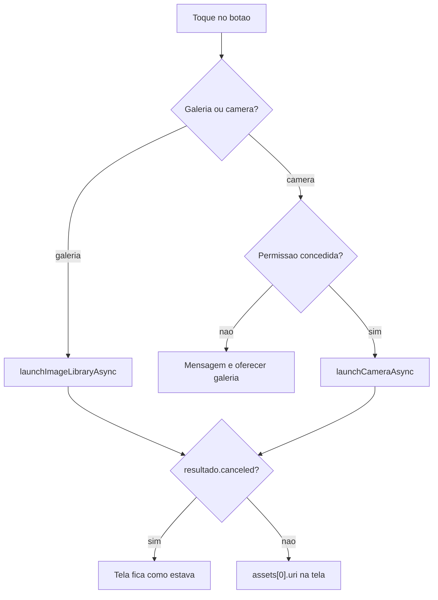
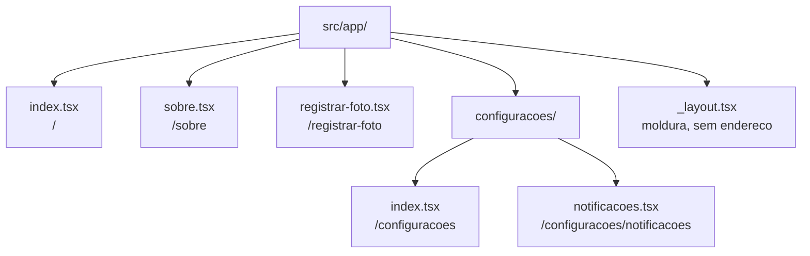
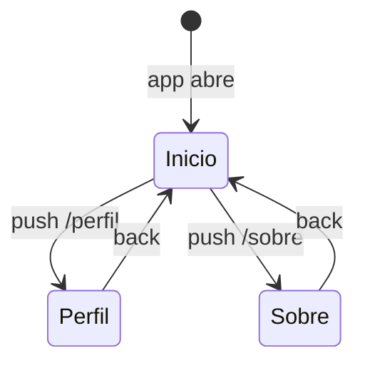
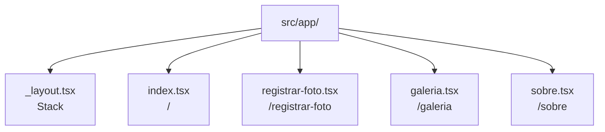

# Notas de Estudo — Aula 6: Galeria e câmera com expo-image-picker e navegação com Expo Router

> **Disciplina:** Desenvolvimento Mobile (2026.2.DM) — CESAR School
> **Dados de versões e ferramentas:** conferidos em **6 de outubro de 2026**. Este material envelhece rápido; as fontes estão no final para você conferir por conta própria.

---

## Visão geral

Na Aula 5 você **construiu** uma câmera inteira com `expo-camera`: permissão, `CameraView`, referência e botão de disparo. Muitas vezes o app não precisa de tudo isso — ele só quer que o usuário **anexe uma foto**, que já tenha no celular ou que tire agora. Para isso existe a câmera (e a galeria) **do sistema**, que você pede emprestada com uma chamada.

E, para mostrar a câmera, você escondeu a lista com um `if` e um `useState`. Funcionou, mas o app continuava sendo **um componente só**, que trocava o que exibia — e o botão de voltar do Android **fechava o app inteiro**, em vez de voltar para a lista. Um app de verdade tem **várias telas**, e o usuário **anda** entre elas: entra numa, volta, entra em outra. Esse andar tem regras que o sistema operacional já conhece — o gesto de voltar no iPhone, o botão de voltar no Android, o título no topo — e você não quer reimplementar nenhuma delas.

Esta aula responde três perguntas:

1. **Como eu pego uma foto que o usuário já tem, ou tiro uma sem construir a câmera?** → **`expo-image-picker`**
2. **Como eu dou um endereço a cada tela do app?** → roteamento por arquivos do **Expo Router**
3. **Como o usuário anda entre as telas, e volta?** → `_layout.tsx` com `Stack`, `Link` e `router`



> **Leitura do diagrama:** o mapa mostra os três blocos da aula, na ordem em que aparecem. O `expo-image-picker` traz fotos da galeria ou da câmera do sistema para dentro do app; o Expo Router dá endereço às telas; a pilha é o modelo mental de como se anda entre elas.

**O arco da aula, em uma frase:** fotos que o usuário já tem, e telas com endereço.



> **Leitura do diagrama:** a tela inicial leva, por `Link` ou `push`, à tela de registrar foto e à tela "sobre"; a tela de foto volta com `back`, e de dentro dela o app abre a galeria ou a câmera **do sistema**, através do `expo-image-picker`.

> 📌 **Sobre o escopo:** esta aula cobre o **`expo-image-picker`** — galeria, câmera, opções, resultado e permissões — e a **base do Expo Router** — arquivos em `src/app/` viram telas, `index.tsx`, `_layout.tsx` com `Stack` e `Stack.Screen`, `Link` com endereço fixo e `router.push` / `router.back`. Ela se apoia em tudo que veio das Aulas 1 a 5 (`View`, `Text`, `StyleSheet`, `useState`, `Pressable`, `FlatList`, o contrato de permissão e o `expo-image`). O restante — como **levar dados de uma tela para outra**, por exemplo — vem nas próximas aulas. Este material **diz onde está esse gancho**, em vez de fingir que ele não existe.

> 📱 **Sobre os exemplos deste material:** o domínio é o **Rastreador de Micro-hábitos** (`Habito`). Se o seu grupo ficou com o **App de Gestão e Rotina Pet**, use o **`practice.md`**: são as mesmas práticas, com os mesmos scaffolds, no domínio `Pet`.

---

# Parte 1 — `expo-image-picker`: a galeria

## 1.1 O que é, e como difere do `expo-camera`

O **`expo-image-picker`** é a biblioteca que **abre a tela do sistema** para o usuário escolher uma foto da galeria ou tirar uma com a câmera, e **devolve o arquivo escolhido** para o seu app.

### 🍽️ Analogia: cozinhar × pedir no balcão

O `expo-camera` da Aula 5 é **montar a cozinha**: você escolhe o fogão, a panela, o botão, o layout. O `expo-image-picker` é **pedir no balcão**: o sistema entrega o prato pronto, do jeito dele, e você só recebe.

| | `expo-camera` (Aula 5) | `expo-image-picker` (hoje) |
|---|---|---|
| A interface | **sua** — `CameraView` na sua tela | **do sistema** — abre por cima do app |
| Galeria | não tem | tem |
| Recorte | você teria que construir | `allowsEditing` |
| Controle (flash, zoom, sobreposição) | total | nenhum |
| Código | gate de permissão + `CameraView` + referência | **uma chamada com `await`** |
| Quando usar | a câmera faz parte da experiência (scanner, filtro, câmera contínua) | **"o usuário anexa uma foto"** |

**A regra de decisão:** se a câmera **é** a funcionalidade, `expo-camera`. Se a foto é **um anexo** — foto de perfil, foto do hábito, foto do pet —, `expo-image-picker`.

## 1.2 Instalação

```bash
npx expo install expo-image-picker
```

**`npx expo install`, não `npm install`** — a regra da Aula 5 continua. O `expo-image` (Aula 5) já deve estar instalado; é ele que vai exibir a foto.

## 1.3 O contrato de três tempos, de novo

Volte à tabela da Aula 5 e acrescente duas linhas:

| Pacote | Pedir | Ler | Parar |
|---|---|---|---|
| `expo-image-picker` — galeria | **não precisa** | `launchImageLibraryAsync()` | — (leitura pontual) |
| `expo-image-picker` — câmera | `requestCameraPermissionsAsync()` | `launchCameraAsync()` | — (leitura pontual) |

- **É um copo d'água, não uma torneira** (analogia da Aula 5): você pede, espera, recebe, acabou. **Não existe `remove()`**, porque não existe assinatura.
- **Por que a galeria não pede permissão:** quem mostra as fotos é o **sistema**, não o seu app. O seu app só recebe a foto que o usuário **escolheu**. É a ideia de privacidade da Aula 5 — *a permissão acompanha o risco* — e aqui o usuário já decidiu, foto por foto.

## 1.4 Abrir a galeria

```tsx
import * as ImagePicker from 'expo-image-picker';

async function escolherDaGaleria() {
  const resultado = await ImagePicker.launchImageLibraryAsync({
    mediaTypes: ['images'],
    allowsEditing: true,
    aspect: [4, 3],
    quality: 0.7,
  });

  if (resultado.canceled) return;
  setFotoUri(resultado.assets[0].uri);
}
```

Chamado de dentro do `onPress` de um `Pressable`, como tudo desde a Aula 4.

| Opção | Valores | Default | O que faz |
|---|---|---|---|
| `mediaTypes` | `['images']`, `['videos']`, `['images', 'videos']` | `'images'` | o que aparece para escolher — **nesta aula, só `['images']`** |
| `allowsEditing` | booleano | `false` | abre a tela de **recorte** depois da escolha |
| `aspect` | `[largura, altura]` | — | proporção do recorte — **só Android** |
| `quality` | **0 a 1** | `1` | compressão do JPEG (1 = qualidade máxima, arquivo maior) |
| `allowsMultipleSelection` | booleano | `false` | deixa escolher várias (§1.6) |
| `selectionLimit` | número | `0` (= máximo do sistema) | teto da seleção múltipla |
| `base64` | booleano | `false` | devolve a imagem como texto — **não peça sem precisar** (regra da Aula 5) |

## 1.5 O resultado: `canceled` e `assets`

```ts
// o usuário escolheu
{ canceled: false, assets: [{ uri, width, height, fileName, fileSize, mimeType, type, ... }] }

// o usuário desistiu
{ canceled: true, assets: null }
```

- **Cancelar não é erro.** Não cai em `catch`, não é exceção. É um resultado **normal**, e o código tem que tratá-lo: `if (resultado.canceled) return;`. A tela fica **como estava** — inclusive com a foto anterior, se houver.
- **`assets` é sempre uma lista**, mesmo quando o usuário escolhe uma foto só. Por isso `assets[0]`.
- **O TypeScript ajuda:** depois do `if (resultado.canceled) return;`, ele **sabe** que `assets` não é `null`. Tire o `if` e veja o erro aparecer no editor.



> **Leitura do diagrama:** o toque leva à galeria direto ou à câmera; a câmera passa antes pela permissão, e um "não" vira uma mensagem que oferece a galeria; nos dois caminhos, o resultado é conferido — se o usuário cancelou, nada muda; se escolheu, o `uri` da primeira foto vai para a tela.

## 1.6 Recorte e seleção múltipla: as diferenças de plataforma

- **`allowsEditing` no Android** deixa recortar **e girar**, respeitando o `aspect`.
- **No iOS**, só recorta, e o recorte é **sempre quadrado** — o `aspect` é ignorado.

É a mesma lição do `timeInterval` da Aula 5: a opção existe, compila, e faz coisas diferentes de cada lado. **Não prometa "4:3" para quem usa iPhone.**

**Seleção múltipla:**

```tsx
const resultado = await ImagePicker.launchImageLibraryAsync({
  mediaTypes: ['images'],
  allowsMultipleSelection: true,
  selectionLimit: 5,
});
if (!resultado.canceled) setFotos(resultado.assets);
```

- `allowsMultipleSelection` **desliga** o `allowsEditing` — não dá para recortar cinco fotos de uma vez. Pedir os dois juntos não é erro; o recorte só não aparece.
- O resultado já é uma **lista**, e vai direto para uma `FlatList` da Aula 4, com `renderItem` fora do componente e `ListEmptyComponent`. A Parte 7 tem o código completo.

## 1.7 Exibir, e onde está o arquivo

```tsx
import { Image } from 'expo-image';

<Image source={{ uri: fotoUri }} style={estilos.previa} contentFit="cover" transition={300} />
```

- **Nada novo:** é o `expo-image` da Aula 5, com as mesmas regras — `contentFit` explícito, **import conferido**.
- **Onde está o arquivo:** o `uri` aponta para uma **cópia no cache do app** — o picker copia o arquivo escolhido para lá. Igual à foto do `takePictureAsync` da Aula 5: **não é permanente**. Se o sistema limpar o cache, o `uri` passa a apontar para nada. Guardar a foto de verdade fica para mais adiante na disciplina.

---

# Parte 2 — `expo-image-picker`: a câmera e as permissões

## 2.1 `launchCameraAsync`: mesma chamada, outra fonte

```tsx
async function tirarFoto() {
  setFalha(null);
  const permissao = await ImagePicker.requestCameraPermissionsAsync();
  if (!permissao.granted) {
    setFalha(permissao.canAskAgain ? 'camera-negada' : 'camera-bloqueada');
    return;
  }

  const resultado = await ImagePicker.launchCameraAsync({
    mediaTypes: ['images'],
    allowsEditing: true,
    aspect: [4, 3],
    quality: 0.7,
  });

  if (resultado.canceled) return;
  setFotoUri(resultado.assets[0].uri);
}
```

**Mesmas opções, mesmo resultado** que a galeria. A diferença é **uma só**: a câmera **sempre** pede permissão.

Reconheça o contrato da Aula 5, linha por linha: **pedir** (`requestCameraPermissionsAsync`) → **tratar o "não"** → **ler** (`launchCameraAsync`).

## 2.2 Os três estados da permissão

| Estado | O que a tela faz |
|---|---|
| `granted` | abre a câmera |
| `!granted` e `canAskAgain: true` | explica, deixa tentar de novo — e **oferece a galeria**, que não precisa de permissão |
| `!granted` e `canAskAgain: false` | o diálogo **não vai mais aparecer**; a tela explica o caminho nas Configurações e **oferece a galeria** |

### 🔴 `canAskAgain: false` — de novo

Com `canAskAgain: false`, chamar `requestCameraPermissionsAsync()` mais vezes **não mostra diálogo nenhum**. A única saída é o usuário liberar a câmera **nas Configurações do aparelho** — e a sua tela tem que dizer isso, com o caminho:

> *"A câmera foi bloqueada. Para liberar, abra Ajustes → Rastreador → Câmera. Enquanto isso, você pode escolher uma foto da galeria."*

**A regra da Aula 5 continua:** os estados de falha são **mensagens diferentes** na tela. E esse é o ganho de experiência do picker: **sempre existe um caminho** — se a câmera não pode, a galeria pode.

## 2.3 As duas formas de perguntar

Igual à Aula 5, o pacote oferece as duas formas:

| Forma | Câmera | Galeria |
|---|---|---|
| chamada direta, dentro do `onPress` | `requestCameraPermissionsAsync()` | `requestMediaLibraryPermissionsAsync()` |
| o par `[estado, pedir]`, no topo do componente | `useCameraPermissions()` | `useMediaLibraryPermissions()` |

- **Para o picker, a chamada direta é a natural:** a permissão só importa **no momento do toque**, e a tela não muda de forma por causa dela.
- O par `[estado, pedir]` faz sentido quando **a tela inteira** depende da permissão — que era o caso do `CameraView` da Aula 5, e não é o caso aqui.

> ⚠️ **A própria documentação diverge — e isso é uma lição.** O texto do `expo-image-picker` diz que **não é preciso pedir permissão para abrir a galeria**, e o exemplo oficial, logo abaixo, **pede** `requestMediaLibraryPermissionsAsync()` antes. As duas coisas valem em contextos diferentes: o picker **do sistema** não precisa; a permissão de biblioteca serve para quem vai **ler a galeria inteira** por conta própria, que não é o nosso caso. **Este material segue o texto:** galeria sem permissão. Ler documentação com um pouco de desconfiança faz parte do trabalho.

## 2.4 O config plugin

```json
{
  "expo": {
    "plugins": [
      [
        "expo-image-picker",
        {
          "photosPermission": "Usamos suas fotos para você anexar a imagem do seu hábito.",
          "cameraPermission": "Usamos a câmera para você registrar a foto do seu hábito.",
          "microphonePermission": false
        }
      ]
    ]
  }
}
```

- `photosPermission` e `cameraPermission` são os textos que o iOS mostra no diálogo. **Mesma regra da Aula 5:** escreva o **porquê**, pensando em quem vai ler.
- **`microphonePermission: false` não é detalhe.** Por padrão, o pacote acrescenta a permissão de microfone (`RECORD_AUDIO`) no Android, porque ele também sabe gravar vídeo. Se o seu app **não** grava vídeo, pedir microfone é pedir o que não usa — e loja e usuário desconfiam. Desligue.
- No Expo Go, isso não faz diferença visível. Na build de verdade, faz. **Escreva agora.**

## 2.5 Simulador, emulador e aparelho

| Onde | Galeria | Câmera |
|---|---|---|
| iOS Simulator | funciona (arraste imagens do computador para dentro dele) | **não tem câmera** |
| Android Emulator | funciona | câmera virtual (uma cena 3D) — serve para testar o fluxo |
| Aparelho físico | funciona | **é onde se testa a câmera** |

> 🔴 **Expo Go no iPhone físico exige login.** Desde 03/09/2026, o Expo Go num iPhone de verdade só abre o projeto se o Expo Go e o Expo CLI estiverem logados na **mesma conta**. No computador: `npx expo login`. Android, emuladores e simuladores não são afetados.

---

# Parte 3 — Roteamento por arquivos: a pasta é o mapa

## 3.1 O que é o Expo Router

O **Expo Router** é a biblioteca de navegação do Expo em que **cada arquivo dentro de `src/app/` vira uma tela**, e o **caminho do arquivo é o endereço da tela**.

### 🏢 Analogia: o prédio e a placa da porta

A pasta `src/app/` é a planta de um prédio. Cada arquivo é uma sala, e o nome do arquivo está escrito na porta. Para mandar alguém a uma sala, você não descreve o caminho pelos corredores — você diz o número da sala: `/sobre`. Quem sabe chegar lá é o Router.

Se você já fez um site, é a mesma ideia de um site estático em que `sobre.html` vira `/sobre`. E não é coincidência: o mesmo app roda na web, e ali o endereço vira uma URL de verdade.

> 💡 **Você já estava usando o Router sem saber.** O sandbox criado com o template `default` já tem `src/app/index.tsx` e `src/app/_layout.tsx` desde a Aula 3. Hoje você descobre o que esses dois arquivos fazem.

## 3.2 A regra de conversão: arquivo → endereço

| Arquivo | Endereço (`href`) |
|---|---|
| `src/app/index.tsx` | `/` |
| `src/app/sobre.tsx` | `/sobre` |
| `src/app/registrar-foto.tsx` | `/registrar-foto` |
| `src/app/configuracoes/index.tsx` | `/configuracoes` |
| `src/app/configuracoes/notificacoes.tsx` | `/configuracoes/notificacoes` |
| `src/app/_layout.tsx` | **nenhum** — não é tela, é moldura (Parte 4) |

**As três regras que saem da tabela:**

1. **`index.tsx` é a tela padrão da pasta.** Em `src/app/`, é a primeira tela do app; em `src/app/configuracoes/`, é o que abre em `/configuracoes`.
2. **Pasta vira pedaço do endereço.** Subpasta = mais um `/`.
3. **Arquivo que começa com `_` não é tela.** O `_layout.tsx` é a exceção que confirma a regra.

**Um truque para nunca errar:** leia o caminho do arquivo em voz alta, **tirando `src/app` do começo e `.tsx` do fim**. O que sobra é o endereço. (`index` some, porque é o padrão da pasta.)



> **Leitura do diagrama:** cada arquivo dentro de `src/app/` aparece com o endereço que ganha; a subpasta `configuracoes/` acrescenta um nível ao endereço, e o `_layout.tsx` é o único arquivo que não vira tela.

> ⚠️ **Nome de arquivo vira URL.** Use **minúsculas e hífen**: `registrar-foto.tsx`, nunca `RegistrarFoto.tsx`. O endereço ficaria `/RegistrarFoto` — e, em Android e Linux, maiúscula e minúscula são coisas diferentes.

## 3.3 O que uma tela precisa ter

```tsx
// src/app/sobre.tsx
import { StyleSheet, Text, View } from 'react-native';

export default function TelaSobre() {
  return (
    <View style={estilos.tela}>
      <Text>Rastreador de Micro-hábitos — versão da Aula 6.</Text>
    </View>
  );
}

const estilos = StyleSheet.create({
  tela: { flex: 1, padding: 24, justifyContent: 'center' },
});
```

- **`export default` é obrigatório.** É assim que o Router encontra o componente da tela. Sem ele, o Router avisa que a rota não tem componente, e a tela não abre.
- **Nada mais é novo.** É um componente igual aos das Aulas 3 a 5. **Uma tela é só um componente num lugar especial.**

## 3.4 🔴 O erro número 1: componente dentro de `src/app/`

**Tudo** o que está em `src/app/` é tratado como rota. Se você salvar o `CardHabito.tsx` lá dentro, o Router tenta transformá-lo numa tela `/CardHabito`.

O resto do código mora **fora** de `src/app/`:

| Pasta | O que vai nela |
|---|---|
| `src/app/` | **só** telas e `_layout.tsx` |
| `src/components/` | componentes reutilizáveis (`CardHabito`, `ListaVazia`...) |
| `src/screens/` | o corpo de telas grandes, se você quiser separar |
| `src/types/`, `src/services/`, `src/lib/` | tipos, serviços, funções utilitárias |

O próprio template diz isso quando você roda `npm run reset-project`:

> *"Put all your application code in /src, only screens and layout files should be in /src/app."*

## 3.5 `app/` ou `src/app/`?

Você vai achar muito tutorial com as rotas numa pasta `app/` na **raiz** do projeto. Desde o **SDK 55**, o template cria **`src/app/`**.

- `app/` na raiz **ainda funciona** — por isso tutorial antigo roda.
- **Se existirem as duas pastas, só `src/app/` é usada.** A outra é ignorada em silêncio, e você vai passar meia hora editando um arquivo que não aparece na tela.
- Ao rodar o projeto, o terminal confirma qual está valendo:
  ```
  Using src/app as the root directory for Expo Router.
  ```
  **Leia essa linha** sempre que algo "não atualiza".

## 3.6 Quem liga o Router: o `"main"` do `package.json`

Nas Aulas 1 e 2, o app começava pelo `index.ts`, que chamava `registerRootComponent(App)` — era ele que dizia "o app começa no `App.tsx`".

Com o Router, quem começa o app é o próprio Router:

```json
{ "main": "expo-router/entry" }
```

**Consequência:** com o Router, **não existe mais `App.tsx`**. O papel dele foi dividido em dois:

- a **moldura** vai para `src/app/_layout.tsx`;
- a **primeira tela** vai para `src/app/index.tsx`.

A Parte 6 mostra como fazer essa migração no projeto do seu grupo.

---

# Parte 4 — `_layout.tsx` e `Stack`: a pilha de telas

## 4.1 O que é um layout

O `_layout.tsx` é o componente que **envolve** as telas da pasta e decide **como** se anda entre elas.

### 🖼️ Analogia: a moldura do quadro

As telas são os quadros que você troca; o layout é a moldura que fica. O cabeçalho com o título e o botão de voltar **é da moldura**, não do quadro.

Nesta aula, a moldura é sempre um **`Stack`** — uma pilha.

## 4.2 O layout mínimo

```tsx
// src/app/_layout.tsx
import { Stack } from 'expo-router';

export default function LayoutRaiz() {
  return <Stack />;
}
```

É exatamente o arquivo que o `reset-project` gera. Só com essas linhas o app já tem:

- cabeçalho com o nome da tela;
- botão de voltar;
- gesto de voltar no iOS;
- botão de voltar do Android funcionando.

## 4.3 A pilha

### 🍽️ Analogia: a pilha de pratos

Cada tela nova é um prato **colocado em cima** (`push`). Voltar é **tirar o prato de cima** (`back`). Você só vê o prato do topo, mas os de baixo continuam lá, do jeito que você deixou.



> **Leitura do diagrama:** o app abre na tela inicial; cada `push` coloca uma tela nova por cima, e cada `back` tira a tela de cima e revela de novo a tela inicial, no mesmo estado em que ela ficou.

**As duas consequências que você precisa guardar:**

1. **A tela de baixo não é recriada quando você volta.** Se o usuário tinha rolado a lista até o meio, ela continua no meio.
2. **A tela de cima, quando sai da pilha, é destruída.** O `useState` dela some. Se o usuário escolheu uma foto em `/registrar-foto` e voltou, aquela foto se foi junto com a tela.

Guarde a segunda — ela é o motivo da nota 🧩 da Parte 5.

## 4.4 Configurar as telas: `Stack.Screen` e `screenOptions`

```tsx
// src/app/_layout.tsx
import { Stack } from 'expo-router';

export default function LayoutRaiz() {
  return (
    <Stack screenOptions={{ headerTintColor: '#f26522' }}>
      <Stack.Screen name="index" options={{ title: 'Meus hábitos' }} />
      <Stack.Screen name="registrar-foto" options={{ title: 'Foto do hábito' }} />
      <Stack.Screen name="galeria" options={{ title: 'Galeria' }} />
      <Stack.Screen name="sobre" options={{ title: 'Sobre o app' }} />
    </Stack>
  );
}
```

- **`name` é o nome do arquivo sem a extensão**, relativo à pasta do layout. `name="registrar-foto"` aponta para `registrar-foto.tsx`. Se errar o nome, o Router avisa no console que não achou a rota, e a opção simplesmente não é aplicada.
- **`screenOptions`** vale para **todas** as telas da pilha. **`options`** vale para **uma**. Se as duas definirem a mesma coisa, a da tela vence.

| Opção | Para quê |
|---|---|
| `title` | texto do cabeçalho |
| `headerShown` | `false` esconde o cabeçalho (tela cheia) |
| `headerTintColor` | cor do título e do botão de voltar |
| `headerStyle` | `{ backgroundColor }` do cabeçalho |
| `headerBackTitle` | texto ao lado da seta de voltar, no iOS |

> 💡 **Listar uma tela no `Stack.Screen` não é obrigatório.** Um arquivo que não está listado continua sendo rota, só que com o título padrão (o nome do arquivo). Você lista para **configurar**, não para **registrar**.

---

# Parte 5 — `Link` e `router`: andar pela pilha

## 5.1 `Link`: o caminho declarado

```tsx
import { Link } from 'expo-router';

<Link href="/sobre" style={estilos.link}>
  Sobre o app
</Link>
```

- **`Link` é um `Text` que navega.** Aceita `style` como um `Text`.
- Para usar o **seu** botão (um `Pressable` da Aula 4) como link, use **`asChild`**:

  ```tsx
  <Link href="/galeria" asChild>
    <Pressable style={estilos.botaoSecundario}>
      <Text style={estilos.textoBotaoSecundario}>Ver galeria</Text>
    </Pressable>
  </Link>
  ```

  O `Link` **passa o toque** para o filho. Sem `asChild`, você teria um `Pressable` dentro de um `Text` — que não é o que você quer.

> ⚠️ **`href` começa com `/`.** `href="/sobre"` é o endereço absoluto. Sem a barra, o endereço passa a ser **relativo** à tela atual — e, dentro de uma subpasta, leva para outro lugar. Regra desta aula: **sempre com a barra**.

## 5.2 `router`: navegar depois de uma ação

```tsx
import { useRouter } from 'expo-router';

export default function TelaInicial() {
  const router = useRouter();
  // ...
  <Pressable onPress={() => router.push('/registrar-foto')}>...</Pressable>
}
```

**`useRouter()` é chamado no topo do componente, sem condicional** — a mesma regra do `useState` e do `useCameraPermissions` da Aula 5. Não é conceito novo; é a mesma forma. A diferença é que ele devolve **um objeto** com funções, em vez de um par.

| Função | O que faz na pilha |
|---|---|
| `router.push('/rota')` | **empilha** a rota por cima |
| `router.back()` | **desempilha** — o mesmo que o botão de voltar |
| `router.canGoBack()` | `true` se existe uma tela embaixo para voltar |
| `router.replace('/rota')` | **troca** a tela do topo, sem deixar a anterior na pilha (típico depois de um login) |

## 5.3 `Link` ou `router.push`?

A pergunta que decide:

> *A navegação acontece **porque o usuário tocou em algo que é um link**, ou **depois que alguma coisa terminou**?*

- "Tocar em *Sobre* leva para a tela Sobre" → **`Link`**. O destino é fixo e está escrito na tela.
- "Depois que a foto foi escolhida, volta para a lista" → **`router.back()`**, dentro da função `async`, **depois** do `await`.

**Regra prática:** `Link` no JSX; `router` dentro de função.

## 5.4 O TypeScript conhece as suas rotas

O template já vem com `"experiments": { "typedRoutes": true }` no `app.json`. Depois do primeiro `npx expo start`, o Router **gera os tipos** das rotas que existem no projeto. Escreva um `href` que não existe, e o editor reclama:

```
Type '"/novaFoto"' is not assignable to type ... Did you mean '"/registrar-foto"'?
```

Um endereço errado é pego **no editor**, antes de rodar.

> ⚠️ **Os tipos só se atualizam quando o `npx expo start` está rodando.** Se você renomeou um arquivo e o TypeScript ainda reclama do nome novo (ou aceita o antigo), rode `npx expo start` de novo para regenerar.

## 5.5 Duas plataformas, um botão de voltar

| Plataforma | Formas de voltar |
|---|---|
| iOS | seta no cabeçalho + **gesto de arrastar da borda esquerda** |
| Android | seta no cabeçalho + **botão ou gesto de voltar do sistema** |

**Todas chamam o mesmo `back`.** Você não escreve nada para isso. E o bug da Aula 5 se resolve sozinho: com a tela de foto numa **rota**, o voltar do Android volta para a lista, em vez de fechar o app.

### 🧩 Nota honesta: hoje as telas não conversam

Você vai querer tocar num hábito da lista e abrir a tela **daquele** hábito. Ou escolher a foto numa tela e vê-la aparecer na lista da outra. As duas coisas exigem **levar informação de uma tela para outra** — e isso **não está nesta aula**. É exatamente o assunto da **Aula 7**.

Por isso, hoje:

- cada tela é **autocontida**: a tela de foto escolhe a foto, mostra a prévia e volta;
- a lista **não** recebe a foto — e, como você viu no §4.3, a tela de foto é destruída quando sai da pilha;
- as rotas são **fixas**: `/sobre`, `/registrar-foto`, `/galeria`.

Isso não é defeito do seu código. É a peça que ainda falta, e ela chega na próxima aula.

---

# Parte 6 — Levando para o seu projeto: de `App.tsx` para `src/app/`

Os repositórios dos dois projetos da disciplina começaram no template `blank-typescript` e ainda abrem pelo `App.tsx`. Para a Atividade Aplicada, você migra o seu para o Router. São seis passos.

**0. Instalar o Router e as dependências dele:**

```bash
npx expo install expo-router react-native-safe-area-context react-native-screens expo-linking expo-constants expo-status-bar
npx expo install expo-image-picker
```

**1. Trocar o ponto de entrada** no `package.json`:

```json
"main": "expo-router/entry"
```

**2. Dar um `scheme` ao app** no `app.json` — é o endereço do app fora dele:

```json
"scheme": "habittracker"
```

O `npx expo install` **já adiciona** `"expo-router"` à lista `plugins` do `app.json`. **Confira, e não duplique.**

**3. Criar a moldura** em `src/app/_layout.tsx` — o `<Stack />` do §4.2.

**4. Transformar a tela atual na rota inicial**, sem mover código:

```tsx
// src/app/index.tsx
export { default } from '../screens/tela-habitos';
```

A tela continua morando em `src/screens/`; a rota só **aponta** para ela. É a regra do §3.4 aplicada: em `src/app/`, só telas e layouts.

**5. Apagar `App.tsx` e `index.ts`** — o papel deles agora é do Router.

**6. Reiniciar limpando o cache:**

```bash
npx expo start --clear
```

E conferir no terminal: `Using src/app as the root directory for Expo Router.`

> ⚠️ **Os três tropeços mais comuns da migração:** esquecer o `"main"` (o app tenta abrir o `App.tsx` que você apagou); deixar a tela **dentro** de `src/app/` *e* em `src/screens/` (duas cópias, e uma vira rota fantasma); não reiniciar com `--clear`.

---

# Parte 7 — Juntando tudo

Um app com quatro rotas estáticas: a tela inicial, a tela de registrar foto (galeria **e** câmera), uma galeria com seleção múltipla e a tela "sobre". Todo este código foi conferido com `tsc` num projeto SDK 57.



> **Leitura do diagrama:** a pasta `src/app/` tem a moldura (`_layout.tsx`, com o `Stack`) e quatro telas, cada uma com o endereço que o nome do arquivo dá a ela.

### `src/app/_layout.tsx`

```tsx
import { Stack } from 'expo-router';

export default function LayoutRaiz() {
  return (
    <Stack screenOptions={{ headerTintColor: '#f26522' }}>
      <Stack.Screen name="index" options={{ title: 'Meus hábitos' }} />
      <Stack.Screen name="registrar-foto" options={{ title: 'Foto do hábito' }} />
      <Stack.Screen name="galeria" options={{ title: 'Galeria' }} />
      <Stack.Screen name="sobre" options={{ title: 'Sobre o app' }} />
    </Stack>
  );
}
```

### `src/app/index.tsx`

```tsx
import { Link, useRouter } from 'expo-router';
import { Pressable, StyleSheet, Text, View } from 'react-native';

export default function TelaInicial() {
  const router = useRouter();

  return (
    <View style={estilos.tela}>
      <Text style={estilos.titulo}>Meus hábitos</Text>

      <Link href="/sobre" style={estilos.link}>
        Sobre o app
      </Link>

      <Link href="/galeria" asChild>
        <Pressable style={estilos.botaoSecundario}>
          <Text style={estilos.textoBotaoSecundario}>Ver galeria</Text>
        </Pressable>
      </Link>

      <Pressable
        onPress={() => router.push('/registrar-foto')}
        style={({ pressed }) => [estilos.botao, pressed && estilos.botaoPressionado]}
      >
        <Text style={estilos.textoBotao}>Registrar com foto</Text>
      </Pressable>
    </View>
  );
}

const estilos = StyleSheet.create({
  tela: { flex: 1, padding: 24, gap: 16, justifyContent: 'center' },
  titulo: { fontSize: 24, fontWeight: '700' },
  link: { fontSize: 16, color: '#f26522', textDecorationLine: 'underline' },
  botao: { backgroundColor: '#f26522', paddingVertical: 14, borderRadius: 10, alignItems: 'center' },
  botaoPressionado: { opacity: 0.7 },
  textoBotao: { color: '#fff', fontWeight: '700', fontSize: 16 },
  botaoSecundario: { borderWidth: 2, borderColor: '#f26522', paddingVertical: 12, borderRadius: 10, alignItems: 'center' },
  textoBotaoSecundario: { color: '#f26522', fontWeight: '700', fontSize: 16 },
});
```

> 💡 Repare nas duas formas de navegar na mesma tela: **`Link`** para "Sobre" e "Ver galeria" (destino fixo, escrito na tela) e **`router.push`** no botão principal. Aqui os dois funcionariam; o `router` passa a ser obrigatório quando a navegação vem **depois** de um `await`, como no "Concluir" da próxima tela.

### `src/app/registrar-foto.tsx`

```tsx
import { useState } from 'react';
import { Pressable, StyleSheet, Text, View } from 'react-native';
import { Image } from 'expo-image';
import * as ImagePicker from 'expo-image-picker';
import { useRouter } from 'expo-router';

type Falha = 'camera-negada' | 'camera-bloqueada';

const MENSAGENS: Record<Falha, string> = {
  'camera-negada': 'Sem a câmera, você ainda pode escolher uma foto da galeria.',
  'camera-bloqueada': 'A câmera foi bloqueada. Para liberar, abra Ajustes → Rastreador → Câmera. Enquanto isso, escolha da galeria.',
};

export default function TelaNovaFoto() {
  const router = useRouter();
  const [fotoUri, setFotoUri] = useState<string | null>(null);
  const [falha, setFalha] = useState<Falha | null>(null);

  async function escolherDaGaleria() {
    const resultado = await ImagePicker.launchImageLibraryAsync({
      mediaTypes: ['images'],
      allowsEditing: true,
      aspect: [4, 3],
      quality: 0.7,
    });

    if (resultado.canceled) return;
    setFotoUri(resultado.assets[0].uri);
  }

  async function tirarFoto() {
    setFalha(null);
    const permissao = await ImagePicker.requestCameraPermissionsAsync();
    if (!permissao.granted) {
      setFalha(permissao.canAskAgain ? 'camera-negada' : 'camera-bloqueada');
      return;
    }

    const resultado = await ImagePicker.launchCameraAsync({
      mediaTypes: ['images'],
      allowsEditing: true,
      aspect: [4, 3],
      quality: 0.7,
    });

    if (resultado.canceled) return;
    setFotoUri(resultado.assets[0].uri);
  }

  return (
    <View style={estilos.tela}>
      {fotoUri ? (
        <Image source={{ uri: fotoUri }} style={estilos.previa} contentFit="cover" transition={300} />
      ) : (
        <View style={[estilos.previa, estilos.semFoto]}>
          <Text>Nenhuma foto ainda</Text>
        </View>
      )}

      <Pressable onPress={escolherDaGaleria} style={estilos.botao}>
        <Text style={estilos.textoBotao}>Escolher da galeria</Text>
      </Pressable>

      <Pressable onPress={tirarFoto} style={estilos.botao}>
        <Text style={estilos.textoBotao}>Tirar foto</Text>
      </Pressable>

      {falha && <Text style={estilos.erro}>{MENSAGENS[falha]}</Text>}

      <Pressable onPress={() => router.back()} disabled={!fotoUri} style={[estilos.botao, !fotoUri && estilos.desligado]}>
        <Text style={estilos.textoBotao}>Concluir</Text>
      </Pressable>
    </View>
  );
}

const estilos = StyleSheet.create({
  tela: { flex: 1, padding: 24, gap: 16 },
  previa: { width: '100%', aspectRatio: 4 / 3, borderRadius: 12 },
  semFoto: { backgroundColor: '#eee', alignItems: 'center', justifyContent: 'center' },
  botao: { backgroundColor: '#f26522', paddingVertical: 14, borderRadius: 10, alignItems: 'center' },
  desligado: { opacity: 0.4 },
  textoBotao: { color: '#fff', fontWeight: '700', fontSize: 16 },
  erro: { fontSize: 15, color: '#b00020' },
});
```

### `src/app/galeria.tsx`

```tsx
import { useState } from 'react';
import { FlatList, Pressable, StyleSheet, Text, View } from 'react-native';
import { Image } from 'expo-image';
import * as ImagePicker from 'expo-image-picker';

function renderFoto({ item }: { item: ImagePicker.ImagePickerAsset }) {
  return <Image source={{ uri: item.uri }} style={estilos.miniatura} contentFit="cover" recyclingKey={item.uri} />;
}

export default function TelaGaleria() {
  const [fotos, setFotos] = useState<ImagePicker.ImagePickerAsset[]>([]);

  async function escolherVarias() {
    const resultado = await ImagePicker.launchImageLibraryAsync({
      mediaTypes: ['images'],
      allowsMultipleSelection: true,
      selectionLimit: 5,
      quality: 0.7,
    });

    if (resultado.canceled) return;
    setFotos(resultado.assets);
  }

  return (
    <View style={estilos.tela}>
      <Pressable onPress={escolherVarias} style={estilos.botao}>
        <Text style={estilos.textoBotao}>Escolher até 5 fotos</Text>
      </Pressable>
      <FlatList
        data={fotos}
        keyExtractor={(foto) => foto.uri}
        renderItem={renderFoto}
        numColumns={3}
        columnWrapperStyle={estilos.linha}
        contentContainerStyle={estilos.grade}
        ListEmptyComponent={<Text>Nenhuma foto escolhida.</Text>}
      />
    </View>
  );
}

const estilos = StyleSheet.create({
  tela: { flex: 1, padding: 24, gap: 16 },
  botao: { backgroundColor: '#f26522', paddingVertical: 14, borderRadius: 10, alignItems: 'center' },
  textoBotao: { color: '#fff', fontWeight: '700', fontSize: 16 },
  grade: { gap: 8 },
  linha: { gap: 8 },
  miniatura: { flex: 1, aspectRatio: 1, borderRadius: 8, maxWidth: '33%' },
});
```

### `src/app/sobre.tsx`

```tsx
import { useRouter } from 'expo-router';
import { Pressable, StyleSheet, Text, View } from 'react-native';

export default function TelaSobre() {
  const router = useRouter();

  return (
    <View style={estilos.tela}>
      <Text>Rastreador de Micro-hábitos — versão da Aula 6.</Text>
      <Pressable onPress={() => router.back()} style={estilos.botao}>
        <Text style={estilos.textoBotao}>Voltar</Text>
      </Pressable>
    </View>
  );
}

const estilos = StyleSheet.create({
  tela: { flex: 1, padding: 24, gap: 16, justifyContent: 'center' },
  botao: { backgroundColor: '#f26522', paddingVertical: 14, borderRadius: 10, alignItems: 'center' },
  textoBotao: { color: '#fff', fontWeight: '700', fontSize: 16 },
});
```

> 🧩 **O que está deliberadamente faltando neste código, e você deve saber:** a foto escolhida em `/registrar-foto` **não aparece** na tela inicial, e as fotos de `/galeria` somem quando você volta. Cada tela vive sozinha. Fazer as telas conversarem — levar a foto de uma para a outra, ou abrir a tela de **um** hábito específico — é o assunto da Aula 7.

---

## O que você vai encontrar por aí × o que vale hoje

| O material antigo ensina | O que vale hoje (06/10/2026) |
|---|---|
| Rotas em `app/` na raiz | **`src/app/`** é o padrão desde o SDK 55; com as duas pastas, só `src/app/` é usada |
| `App.tsx` com `NavigationContainer` e `createNativeStackNavigator()` | `"main": "expo-router/entry"` + `src/app/_layout.tsx` com `<Stack />` |
| `navigation.navigate('NomeDaTela')` | `router.push('/endereco')` ou `<Link href="/endereco">` |
| `import ... from '@react-navigation/native'` no código do app | Desde o SDK 56, o app importa de `expo-router` |
| "`router.navigate` volta para a tela se ela já existe" | Hoje `navigate` **empilha**, como `push`. Use `push`, explícito |
| "Expo Router v4 / v5" | O pacote segue o número do SDK: `expo-router@57` |
| `mediaTypes: ImagePicker.MediaTypeOptions.Images` | `mediaTypes: ['images']` — `MediaTypeOptions` está **deprecado** |
| `if (!result.cancelled)` (dois "l") | **`result.canceled`** (um "l") |
| `setImage(result.uri)` | **`result.assets[0].uri`** — não existe mais `uri` no topo |
| `Permissions.askAsync(Permissions.CAMERA_ROLL)` | o pacote `expo-permissions` saiu do SDK; cada biblioteca traz as suas funções |
| `requestCameraRollPermissionsAsync()` | `requestMediaLibraryPermissionsAsync()` |
| "Peça permissão da galeria antes de abrir o picker" | O picker do sistema **não exige**; a câmera **sempre** exige |
| "`aspect` define a proporção do recorte" | **Só no Android**; no iOS o recorte é sempre quadrado |

> 🔴 **Por que o `cancelled` é o pior da lista:** em JavaScript sem tipagem, `result.cancelled` é simplesmente `undefined` — ou seja, falso —, e o código segue como se o usuário tivesse escolhido uma foto, quebrando logo depois em `assets[0]` com `assets` nulo. **O TypeScript pega esse erro; o tutorial em JavaScript, não.**

---

## Erros comuns (consulte antes de pedir ajuda)

| Sintoma | Causa provável | Correção |
|---|---|---|
| `Cannot read property 'uri' of undefined` | tutorial antigo: `result.uri` | `result.assets[0].uri` (§1.5) |
| O app quebra quando o usuário cancela | faltou `if (resultado.canceled) return;` | Cancelar é resultado normal (§1.5) |
| `MediaTypeOptions` riscado no editor | opção deprecada | `mediaTypes: ['images']` (§1.4) |
| No iPhone o recorte vem quadrado | `aspect` é só Android | Comportamento esperado (§1.6) |
| O recorte não aparece com seleção múltipla | `allowsMultipleSelection` desliga o recorte | Comportamento esperado (§1.6) |
| `contentFit` não faz nada | import do `Image` errado | Importar de `expo-image` (§1.7) |
| A câmera não abre no iOS Simulator | o simulador não tem câmera | Aparelho físico (§2.5) |
| O botão "Tirar foto" não mostra mais o diálogo | `canAskAgain: false` | Mensagem com o caminho nas Configurações + galeria (§2.2) |
| O Expo Go no iPhone não abre o projeto | login obrigatório | `npx expo login`, mesma conta no app (§2.5) |
| O app pede microfone sem gravar vídeo | padrão do plugin no Android | `"microphonePermission": false` (§2.4) |
| Aparece uma tela `/CardHabito` que você não criou | componente salvo dentro de `src/app/` | Mover para `src/components/` (§3.4) |
| A tela não abre; o Router diz que a rota não tem componente | falta o `export default` | `export default function ...` (§3.3) |
| Você edita o arquivo e nada muda na tela | existem `app/` **e** `src/app/` | Só `src/app/` vale; apagar a outra (§3.5) |
| O app ainda abre o `App.tsx`, ou reclama que ele sumiu | `"main"` não foi trocado | `"main": "expo-router/entry"` (§3.6, Parte 6) |
| O cabeçalho mostra o nome do arquivo | tela sem `title` | `Stack.Screen` com `options={{ title }}` (§4.4) |
| A opção do `Stack.Screen` não é aplicada | `name` com extensão ou nome errado | `name="registrar-foto"`, sem `.tsx` (§4.4) |
| O link leva para o lugar errado | `href` sem a barra inicial | `href="/sobre"` (§5.1) |
| O botão dentro do `Link` não responde direito | falta `asChild` | `<Link href="..." asChild>` (§5.1) |
| `navigation is not defined` / `navigation.navigate` | tutorial de React Navigation | `router.push('/rota')` (quadro de zumbis) |
| O TypeScript reclama de um `href` que existe | tipos das rotas desatualizados | Rodar `npx expo start` de novo (§5.4) |
| A foto escolhida não aparece na lista | é a limitação desta aula | Telas não conversam ainda (nota 🧩 da Parte 5) |

---

## Perguntas para autoavaliação

Responda sem olhar o material. Se travar em alguma, o número da seção está do lado.

1. Foto de perfil: `expo-camera` ou `expo-image-picker`? E um leitor de QR code? *(§1.1)*
2. Por que a galeria não pede permissão, e a câmera pede? *(§1.3)*
3. O usuário tocou em "Cancelar" na galeria. O que vem em `resultado`? O código cai no `catch`? *(§1.5)*
4. Quantos problemas tem a linha `if (!result.cancelled) setImage(result.uri)`? *(§1.5 e quadro de zumbis)*
5. Pedi `aspect: [4, 3]` e, no iPhone, o recorte veio quadrado. É bug? *(§1.6)*
6. Com `canAskAgain: false`, o que a tela deve fazer? E qual é o caminho que sempre continua disponível? *(§2.2)*
7. Para que serve `"microphonePermission": false` num app que só tira fotos? *(§2.4)*
8. Qual o endereço do arquivo `src/app/configuracoes/index.tsx`? E de `src/app/_layout.tsx`? *(§3.2)*
9. Por que o `CardHabito.tsx` não pode ficar dentro de `src/app/`? Onde ele deve ficar? *(§3.4)*
10. O projeto tem uma pasta `app/` e uma `src/app/`. Qual o Router usa? Como você confirma? *(§3.5)*
11. Com o Router, o que substitui o `App.tsx`? E o `index.ts` com `registerRootComponent`? *(§3.6)*
12. Explique a navegação com a analogia da **pilha de pratos**: o que `push` faz? E `back`? *(§4.3)*
13. Você foi de `/` para `/registrar-foto` e voltou. A lista da tela inicial foi recriada? E o `useState` da tela de foto? *(§4.3)*
14. Qual a diferença entre `screenOptions` e `options`? *(§4.4)*
15. Uma tela que não aparece em nenhum `Stack.Screen` deixa de ser rota? *(§4.4)*
16. Quando usar `Link`, e quando usar `router.push` ou `router.back`? *(§5.3)*
17. O que muda entre `href="/sobre"` e `href="sobre"`? *(§5.1)*
18. Um tutorial escreve `navigation.navigate('Sobre')`. Como fica no nosso projeto? *(quadro de zumbis)*
19. Por que a foto escolhida em `/registrar-foto` não aparece na tela inicial? *(nota 🧩 da Parte 5)*

---

## Leitura recomendada

Em ordem de utilidade para esta aula:

1. [Core concepts (Expo Router)](https://docs.expo.dev/router/basics/core-concepts/) — as regras do roteamento por arquivos, em uma página.
2. [Navigation (Expo Router)](https://docs.expo.dev/router/basics/navigation/) — `Link`, `asChild` e `useRouter`.
3. [ImagePicker](https://docs.expo.dev/versions/latest/sdk/imagepicker/) — leia a lista de opções do `ImagePickerOptions` e o formato do `ImagePickerAsset`.
4. [Stack (Expo Router)](https://docs.expo.dev/router/advanced/stack/) — as opções de cabeçalho.
5. [Top-level src directory](https://docs.expo.dev/router/reference/src-directory/) — curta, e explica de vez a história do `app/` × `src/app/`.

---

## Fontes dos dados citados

Verificadas em **6 de outubro de 2026**.

**Documentação oficial do Expo — `expo-image-picker`**
- [ImagePicker](https://docs.expo.dev/versions/latest/sdk/imagepicker/) — `launchImageLibraryAsync` e `launchCameraAsync`; `ImagePickerOptions` (`mediaTypes` com default `'images'`, `allowsEditing`, `aspect` só Android, `quality` de 0 a 1, `allowsMultipleSelection`, que ignora `allowsEditing`, `selectionLimit` com default 0, `base64`); `MediaTypeOptions` marcado **deprecado**; resultado `{ canceled, assets }` e campos do `ImagePickerAsset`; funções e hooks de permissão; a nota *"No permissions request is necessary for launching the image library"* e o exemplo que ainda pede a permissão; config plugin (`photosPermission`, `cameraPermission`, `microphonePermission`, e o `RECORD_AUDIO` adicionado por padrão); a nota de que o iOS Simulator não tem câmera
- Tipagens conferidas no pacote publicado `expo-image-picker@57.0.20`
- Nomes antigos (`requestCameraRollPermissionsAsync`, `cancelled`) conferidos no pacote `expo-image-picker@10.0.0`

**Documentação oficial do Expo — Expo Router**
- [Core concepts](https://docs.expo.dev/router/basics/core-concepts/) e [Notation](https://docs.expo.dev/router/basics/notation/) — arquivo vira rota, `index`, `_layout`, código que não é rota fica fora de `src/app`
- [Navigation](https://docs.expo.dev/router/basics/navigation/) — `Link`, `asChild`, `useRouter`, `push` / `back` / `replace` / `canGoBack`
- [Stack](https://docs.expo.dev/router/advanced/stack/) — `Stack`, `Stack.Screen`, `screenOptions`, `options`
- [Top-level src directory](https://docs.expo.dev/router/reference/src-directory/) — `src/app` no template desde o SDK 55; com as duas pastas, só `src/app` é usada
- [Typed routes](https://docs.expo.dev/router/reference/typed-routes/) — `experiments.typedRoutes` e a geração de tipos
- [Install Expo Router](https://docs.expo.dev/router/installation/) — dependências, `"main": "expo-router/entry"`, `scheme`
- [Migrating from SDK 55 to 56](https://docs.expo.dev/router/migrate/sdk-55-to-56/) — fim dos imports de `@react-navigation/*` no código do app
- [create-expo-app](https://docs.expo.dev/more/create-expo/) — o template `default` já inclui Expo Router e TypeScript
- Comportamento do `navigate`: [expo/expo#35212](https://github.com/expo/expo/issues/35212) e [expo/expo#37469](https://github.com/expo/expo/issues/37469)
- Conferido em projeto de teste (SDK 57): o `reset-project` gera `src/app/index.tsx` e `src/app/_layout.tsx`; o terminal imprime `Using src/app as the root directory for Expo Router.`; o `tsc` rejeita `href` de rota inexistente, com sugestão; o `npx expo install expo-router` adiciona o plugin ao `app.json` sozinho

**Versões e ecossistema**
- [Expo SDK 57 — changelog](https://expo.dev/changelog/sdk-57) — SDK 57 (30/06/2026) = React Native 0.86 + React 19.2
- [Expo SDK 58 beta](https://expo.dev/changelog/sdk-58-beta) — em beta desde 15/09/2026
- [Expo Go 57 e login obrigatório](https://expo.dev/changelog/expo-go-57-login) e [Sign-in required](https://docs.expo.dev/troubleshooting/expo-go-sign-in-required/) — login exigido em iPhone físico desde 03/09/2026
- [npm — expo](https://www.npmjs.com/package/expo), [expo-router](https://www.npmjs.com/package/expo-router), [expo-image-picker](https://www.npmjs.com/package/expo-image-picker) — versões `latest` em 06/10/2026: 57.0.27, 57.0.24 e 57.0.20

**Pré-requisitos usados, não reensinados**
- [Pressable](https://reactnative.dev/docs/pressable) e [FlatList](https://reactnative.dev/docs/flatlist) — Aula 4
- [expo-image](https://docs.expo.dev/versions/latest/sdk/image/) e o contrato de permissão — Aula 5

**Bibliografia da disciplina**
- [Introduction · React Native](https://reactnative.dev/docs/getting-started)
- *React Native: Desenvolvimento de aplicativos mobile com React* — Escudelario & Pinho
