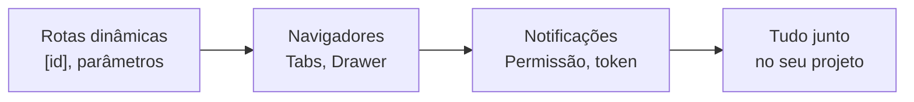
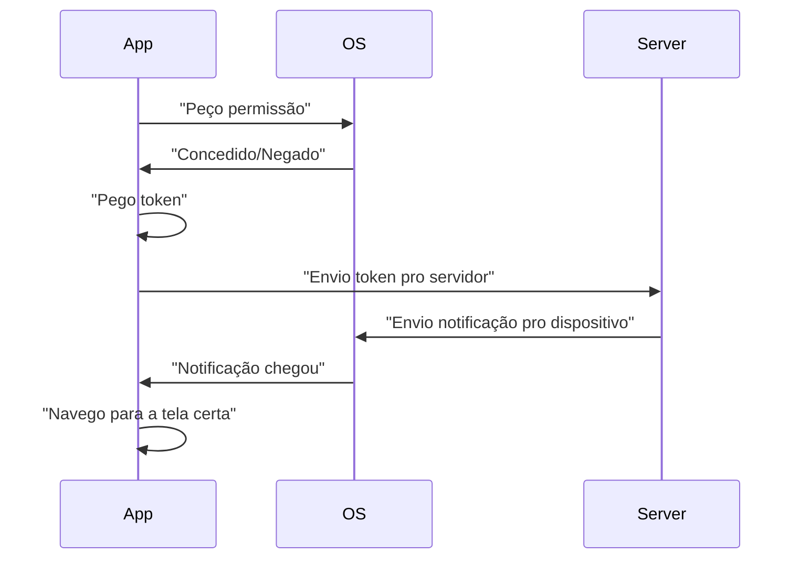

# Apresentação — Aula 7: Navegação avançada com Expo Router e Push Notifications

> Estrutura em Marp/Markdown. Para projetar, use o arquivo `presentation.html` (reveal.js offline).

---

## Slide 1: Abertura

# Aula 7
## Navegação avançada + Notificações

- De volta para onde deixou
- Rotas que sabem de qual item estão falando
- Menus de abas e laterais
- Avisos do app

<!-- 
Gancho: "Na aula passada, tudo era estático. Hoje, a tela de detalhe abre quando você toca."
-->

---

## Slide 2: O que vamos cobrir



**Tempo:** 3 horas

**Formato:** Expositivo + checkpoints + hands-on

---

## Slide 3: Stack vs. Tabs vs. Drawer

| | Stack | Tabs | Drawer |
|---|---|---|---|
| Navegação | `push`/`back` | Toque aba | Desliza lateral |
| Estrutura | Pilha | Menu embaixo | Menu do lado |
| Quando | Sequencial | Seções paralelas | Acesso global |

---

## Slide 4: Rotas dinâmicas — o que é

**Rota estática:** `/sobre` — sempre a mesma coisa

**Rota dinâmica:** `/habit/5`, `/habit/42` — mesma tela, dados diferentes

```tsx
// Arquivo
src/app/habit/[id].tsx

// URLs que funciona
/habit/123
/habit/abc
/habit/456
```

<!-- 
Analogi "gaveta de fotos": a pasta é a mesma, mas a foto dentro muda.
-->

---

## Slide 5: Como navegar para rota dinâmica

```tsx
// Forma 1: Link
<Link href={{ pathname: '/habit/[id]', params: { id: '5' } }}>
  Abrir hábito 5
</Link>

// Forma 2: router.push
router.push({
  pathname: '/habit/[id]',
  params: { id: '5' }
})
```

**Parâmetro é sempre string.**

---

## Slide 6: Ler os parâmetros

```tsx
import { useLocalSearchParams } from 'expo-router';

export default function HabitDetail() {
  const { id } = useLocalSearchParams<{ id: string }>();

  useEffect(() => {
    // Carregar hábito
    fetchHabit(id);
  }, [id]);

  return <Text>Hábito: {id}</Text>;
}
```

<!--
Ponto: useLocalSearchParams é o padrão. useGlobalSearchParams é raro.
-->

---

## Slide 7: Remount vs. atualização

```tsx
router.push({ pathname: '/habit/[id]', params: { id: '5' } });
router.push({ pathname: '/habit/[id]', params: { id: '6' } });
// ⬆️ Segunda chamada **remonta** o componente
```

**Consequência:** lista no fundo é destruída. Voltar com `back()` a traz.

---

## Slide 8: Checkpoint — Rotas dinâmicas

1. Quando usar rota dinâmica vs. estática?
2. Arquivo `/app/post/[postId]/comment.tsx` — qual a URL?
3. Como navegar com parâmetro em JavaScript?
4. O que `useLocalSearchParams<{ id: string }>()` retorna?

<!-- Pausa 60 s para duplas responderem -->

---

## Slide 9: Tabs — estrutura

```
src/app/
  (tabs)/
    _layout.tsx        ← Define as abas
    index.tsx          ← Aba 1
    search.tsx         ← Aba 2
    profile.tsx        ← Aba 3
```

**Pasta com parênteses `(tabs)` não vira rota!**

---

## Slide 10: Tabs — implementação

```tsx
// app/(tabs)/_layout.tsx
import { Tabs } from 'expo-router';

export default function TabLayout() {
  return (
    <Tabs screenOptions={{ tabBarActiveTintColor: '#007AFF' }}>
      <Tabs.Screen
        name="index"
        options={{
          title: 'Home',
          tabBarIcon: ({ color }) => <Icon name="home" color={color} />
        }}
      />
      <Tabs.Screen
        name="settings"
        options={{
          title: 'Settings',
          tabBarIcon: ({ color }) => <Icon name="cog" color={color} />
        }}
      />
    </Tabs>
  );
}
```

---

## Slide 11: Tabs — cada aba

```tsx
// app/(tabs)/index.tsx
import { View, Text } from 'react-native';

export default function HomeTab() {
  return (
    <View style={{ flex: 1, justifyContent: 'center' }}>
      <Text>Home</Text>
    </View>
  );
}

// app/(tabs)/settings.tsx — similar
```

**Cada aba é um componente normal.**

---

## Slide 12: Checkpoint — Tabs

1. Por que a pasta se chama `(tabs)` e não `tabs`?
2. Onde você define os ícones das abas?
3. Se você desce a lista em Home e toca Search, volta e lista continua no topo ou no meio?

<!-- Pausa 60 s -->

---

## Slide 13: Drawer — o que é

**Menu lateral** que desliza de fora para dentro (ou vice-versa).

```
┌──────────────────────┐
│ [☰] Home Title       │
├──────────────────────┤
│ • Menu lateral       │ <- Desliza de cá
│ • About              │
│ • Settings           │
│                      │
│ ┌──────────────────┐ │
│ │  Conteúdo da     │ │
│ │  tela            │ │
│ └──────────────────┘ │
```

**Gesto:** iOS = arrastar borda; Android = deslizar lateral.

---

## Slide 14: Drawer — instalação

```bash
npx expo install react-native-reanimated react-native-worklets react-native-gesture-handler
```

**Obrigatório.** Sem isso, Drawer não funciona.

---

## Slide 15: Drawer — implementação

```tsx
// app/_layout.tsx
import { Drawer } from 'expo-router/drawer';

export default function DrawerLayout() {
  return (
    <Drawer screenOptions={{ drawerActiveTintColor: '#007AFF' }}>
      <Drawer.Screen
        name="(tabs)"
        options={{
          drawerLabel: 'Home',
          drawerIcon: ({ color }) => <Icon name="home" color={color} />
        }}
      />
      <Drawer.Screen
        name="about"
        options={{ drawerLabel: 'About' }}
      />
      <Drawer.Screen
        name="settings"
        options={{ drawerLabel: 'Settings' }}
      />
    </Drawer>
  );
}
```

---

## Slide 16: Drawer — abrir por código

```tsx
import { useNavigation } from '@react-navigation/native';

export default function HomeTab() {
  const navigation = useNavigation();

  return (
    <Pressable onPress={() => navigation.openDrawer()}>
      <Text>☰ Menu</Text>
    </Pressable>
  );
}
```

**Import é de `@react-navigation/native`, não `expo-router`.**

---

## Slide 17: Checkpoint — Drawer

1. Três libs instaladas — quais são?
2. Pasta `(tabs)` dentro de Drawer — o que significa?
3. Como abrir o Drawer sem gesto (por código)?

<!-- Pausa 45 s -->

---

## Slide 18: Notificações — fluxo



> **Hoje:** até "Notificação chegou". Push remoto é depois.

---

## Slide 19: Notificações — permissão

```tsx
import * as Notifications from 'expo-notifications';

const { status } = await Notifications.requestPermissionsAsync();

if (status !== 'granted') {
  console.log('Permissão negada');
  return;
}

console.log('Permissão concedida');
```

**iOS:** dialog "O app gostaria de enviar notificações. Permitir?"

**Android (≥13):** similar.

---

## Slide 20: Notificações — pegar token

```tsx
import Constants from 'expo-constants';

async function getToken() {
  const projectId = Constants?.expoConfig?.extra?.eas?.projectId;
  if (!projectId) {
    console.log('Sem projectId');
    return;
  }

  const { status } = await Notifications.requestPermissionsAsync();
  if (status !== 'granted') return;

  const token = await Notifications.getExpoPushTokenAsync({ projectId });
  console.log('Token:', token.data);
  
  // Envie para o backend aqui
  return token.data;
}
```

**Token identifica o dispositivo.**

---

## Slide 21: Notificações — comportamento em foreground

```tsx
Notifications.setNotificationHandler({
  handleNotification: async () => ({
    shouldPlaySound: true,
    shouldSetBadge: true,
    shouldShowBanner: true,
  }),
});
```

**Sem isso:** notificação chega mas não mostra quando app está aberto.

---

## Slide 22: Notificações — registrar listeners

```tsx
useEffect(() => {
  // Notificação chegou
  const listener1 = Notifications.addNotificationReceivedListener(
    (notification) => {
      console.log('Notificação recebida:', notification);
    }
  );

  // Usuário tocou
  const listener2 = Notifications.addNotificationResponseReceivedListener(
    (response) => {
      console.log('Tocou em:', response);
      // Navegar para tela certa
      router.push('/habit/' + response.notification.request.content.data.habitId);
    }
  );

  return () => {
    listener1.remove();
    listener2.remove();
  };
}, []);
```

---

## Slide 23: Notificações — agendar local

```tsx
<Pressable onPress={async () => {
  await Notifications.scheduleNotificationAsync({
    content: {
      title: 'Hora do hábito!',
      body: 'Não esqueça da sua rotina.',
      data: { habitId: '5' },
      sound: 'default',
      badge: 1,
    },
    trigger: { seconds: 5 },
  });
}}>
  <Text>Agendar em 5s</Text>
</Pressable>
```

**Simulador/Emulador:** funciona. **App fechado:** notificação chega igual.

---

## Slide 24: Checkpoint — Notificações

1. Qual a diferença entre `requestPermissionsAsync` e `getExpoPushTokenAsync`?
2. Quando `setNotificationHandler` é necessário?
3. Qual listener roda quando usuário toca na notificação?
4. No simulador iOS você consegue testar push remoto?

<!-- Pausa 45 s -->

---

## Slide 25: Resumo — Tudo junto

```tsx
// App com Drawer (menu) + Tabs (seções) + Rotas dinâmicas + Notificações

// app/_layout.tsx → Drawer
<Drawer>
  <Drawer.Screen name="(tabs)" ... />
  <Drawer.Screen name="about" ... />
</Drawer>

// app/(tabs)/_layout.tsx → Tabs
<Tabs>
  <Tabs.Screen name="index" ... />
  <Tabs.Screen name="detail/[id]" href={null} />
</Tabs>

// app/(tabs)/detail/[id].tsx → Rota dinâmica
const { id } = useLocalSearchParams<{ id: string }>();
// Notificação toca aqui ↓
// router.push({ pathname: '/(tabs)/detail/[id]', params: { id: '5' } })
```

---

## Slide 26: Próximos passos (não é aula)

- Compor múltiplos navegadores (Drawer + Tabs + Stack com seus próprios Stacks)
- Push notificações remotas (Firebase, Expo Push Service)
- Deep linking (notificação abre a tela certa com URL)
- Persistência de estado (useContext, Redux)

---

## Slide 27: Fechamento

✅ Rotas dinâmicas — tela muda com parâmetro

✅ Navegadores — Stack (pilha), Tabs (abas), Drawer (menu lateral)

✅ Notificações — permissão, token, listeners, foreground/background

🚀 Seu app agora sabe em qual hábito está e avisa o usuário

---
