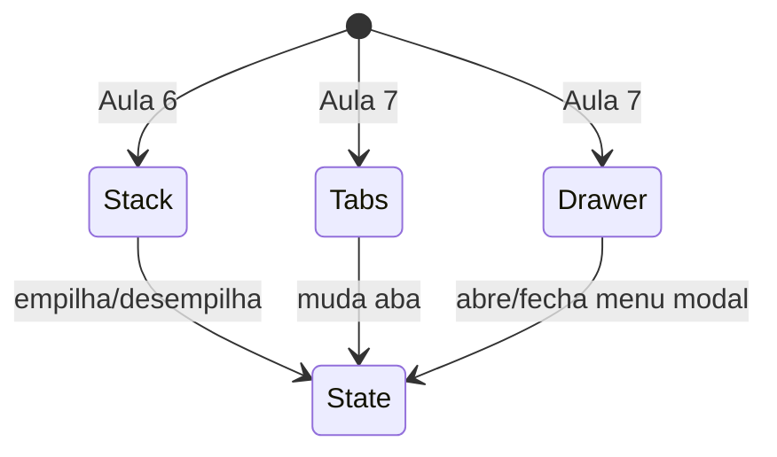

# Notas para estudo — Aula 7: Navegação avançada com Expo Router e Push Notifications

> ⚠️ **Escopo desta aula:** rotas dinâmicas (`[id]`, parâmetros, `useLocalSearchParams`), navegadores alternativos (Tabs, Drawer), e push notifications (permissão, token, listeners, foreground/background). Composição de múltiplos navegadores e push remoto com backend ficam para depois.

---

## 1. Rotas dinâmicas — entender parâmetros

### Quando usar rota dinâmica

Uma rota é **dinâmica** quando a tela muda de **conteúdo** mas é a **mesma estrutura**:

- Detalhe de hábito: `/habit/5`, `/habit/42` — mesma tela, dados diferentes.
- Editar um pet: `/pet/10/edit`, `/pet/11/edit`.
- Resultado de busca: `/search/[query]`.

Rota é **estática** se o conteúdo não muda:

- Sobre: `/sobre` — sempre a mesma coisa.
- Configurações: `/settings`.

### Sintaxe de arquivo

| Arquivo | Aceita | Parâmetro |
|---|---|---|
| `src/app/habit/[id].tsx` | `/habit/123`, `/habit/abc` | `{ id: "123" }` |
| `src/app/habit/[id]/edit.tsx` | `/habit/123/edit` | `{ id: "123" }` |
| `src/app/[...rest].tsx` | qualquer coisa: `/a/b/c` | `{ rest: ["a", "b", "c"] }` |

- **Colchetes têm significado:** `[id]` é parâmetro, não nome de arquivo.
- **A pasta é prefixo:** `/app/post/[postId].tsx` → `/post/123`.

### Navegação para rota dinâmica

**Forma 1: Link com objeto**
```tsx
<Link href={{ pathname: '/habit/[id]', params: { id: '5' } }}>
  Ver hábito 5
</Link>
```

**Forma 2: router.push**
```tsx
const router = useRouter();
<Pressable onPress={() => 
  router.push({
    pathname: '/habit/[id]',
    params: { id: '5' }
  })
}>
  <Text>Ir para hábito 5</Text>
</Pressable>
```

**Forma 3: String simples (menos tipo-segura)**
```tsx
<Link href={`/habit/5`}>
  Ver hábito 5
</Link>
```

### Ler os parâmetros

```tsx
import { useLocalSearchParams } from 'expo-router';
import { useEffect } from 'react';

export default function HabitDetail() {
  // Ler parâmetro 'id' da rota
  const { id } = useLocalSearchParams<{ id: string }>();

  useEffect(() => {
    // Carregar dados do hábito
    if (id) {
      console.log('Carregando hábito:', id);
      // fetchHabit(id);
    }
  }, [id]);

  return (
    <View>
      <Text>Hábito: {id}</Text>
    </View>
  );
}
```

- **`useLocalSearchParams()`** retorna um objeto com parâmetros da **rota de arquivo** (`[id]`, etc.).
- **Genérico `<{ id: string }>`** ajuda o TypeScript — se digitou `{id}` mas a rota tem `{userId}`, erro no editor.
- **Parâmetros são strings** — se precisar de número, converta: `const id = parseInt(params.id, 10)`.
- **Use em `useEffect`** — quando `id` muda, refetch. Padrão garantido.

### Remount vs. atualização

**Quando você navega para a mesma rota com parâmetro diferente, a tela é remontada:**

```tsx
router.push({ pathname: '/habit/[id]', params: { id: '5' } });   // monta
router.push({ pathname: '/habit/[id]', params: { id: '6' } });   // **remonta**, useEffect roda de novo
```

**Consequência:** se você tem uma lista e toca um item para abrir detalhe, a lista é **destruída**. Voltar com `back()` a traz de volta (estado preservado pela pilha).

---

## 2. Navegadores: Stack × Tabs × Drawer

Escolha **um** desses por vez. Cada um é uma forma de organizar telas:

### Stack (pilha) — Aula 6, base

```tsx
// app/_layout.tsx
<Stack>
  <Stack.Screen name="index" options={{ title: 'Home' }} />
  <Stack.Screen name="detail" options={{ title: 'Detalhe' }} />
</Stack>
```

- Você **empilha** telas: `push` uma, depois outra por cima.
- Botão **voltar** tira da pilha.
- Tela de **baixo preservada** — se volta, está como deixou.

### Tabs (abas) — lado a lado

```tsx
// app/(tabs)/_layout.tsx
<Tabs>
  <Tabs.Screen name="index" options={{ 
    title: 'Home',
    tabBarIcon: ({ color }) => <Icon name="home" color={color} />
  }} />
  <Tabs.Screen name="settings" options={{
    title: 'Settings',
    tabBarIcon: ({ color }) => <Icon name="cog" color={color} />
  }} />
</Tabs>
```

- **Muda direto** entre abas — sem pilha.
- **Estado de cada aba preservado** — se volta, scroll continua onde deixou.
- **Cada aba é uma tela normal** — `app/(tabs)/index.tsx`, `app/(tabs)/settings.tsx`.
- **Pasta com `(parênteses)`** não vira rota — é só organizador.

### Drawer (menu lateral) — modal

```tsx
// app/_layout.tsx (precisa instalar libs!)
<Drawer>
  <Drawer.Screen name="(tabs)" options={{ 
    drawerLabel: 'Home',
    drawerIcon: ({ color }) => <Icon name="home" color={color} />
  }} />
  <Drawer.Screen name="settings" options={{
    drawerLabel: 'Settings'
  }} />
</Drawer>
```

- **Menu desliza de fora** para dentro (ou de dentro pra fora).
- **Gesto:** iOS = arrastar borda esquerda; Android = deslizar de lado ou botão no cabeçalho.
- **Abrir por código:** `navigation.openDrawer()`.
- **Precisa:**
  ```bash
  npx expo install react-native-reanimated react-native-worklets react-native-gesture-handler
  ```



> **Leitura do diagrama:** cada navegador é uma forma de ir de um estado a outro; escolha um.

---

## 3. Push Notifications — receber avisos

### Permissão

```tsx
import * as Notifications from 'expo-notifications';

const { status } = await Notifications.requestPermissionsAsync();
if (status !== 'granted') {
  console.log('Permissão negada');
  return;
}
console.log('Permissão concedida');
```

- **iOS:** mostra um dialog. Usuário aceita ou nega.
- **Android (≥13):** similar.
- **Semfre pedir** antes de qualquer operação com notificações.

### Obter token

```tsx
import Constants from 'expo-constants';

async function getToken() {
  const projectId = Constants?.expoConfig?.extra?.eas?.projectId;
  if (!projectId) {
    console.log('Sem projectId');
    return;
  }

  const { status } = await Notifications.requestPermissionsAsync();
  if (status !== 'granted') return;

  const token = await Notifications.getExpoPushTokenAsync({ projectId });
  console.log('Token:', token.data);
  // Envie para o backend
  return token.data;
}
```

- **Token identifica o dispositivo** — use para notificações remotas.
- **Muda quando:** app é reinstalado, dispositivo é resetado, ou credenciais mudam.
- **Sem `projectId`, falha** — confira `app.json`.

### Configurar comportamento em foreground

```tsx
Notifications.setNotificationHandler({
  handleNotification: async () => ({
    shouldPlaySound: true,
    shouldSetBadge: true,
    shouldShowBanner: true,
  }),
});
```

- **Sem isso, notificação chega mas não mostra** quando app está aberto.
- Rode uma vez no topo do componente principal.

### Registrar listeners

```tsx
useEffect(() => {
  // Notificação chegou (app aberto ou não)
  const listener1 = Notifications.addNotificationReceivedListener(
    (notification) => {
      console.log('Notificação recebida:', notification);
    }
  );

  // Usuário tocou na notificação
  const listener2 = Notifications.addNotificationResponseReceivedListener(
    (response) => {
      console.log('Notificação tocada:', response);
      // Navegar para a tela certa aqui
    }
  );

  // Limpar ao desmontar
  return () => {
    listener1.remove();
    listener2.remove();
  };
}, []);
```

- **`addNotificationReceivedListener`** — notificação chega.
- **`addNotificationResponseReceivedListener`** — usuário tocou. **Use para navegar.**
- **Sempre limpar** (`listener.remove()`) ao desmontar — evita memory leaks.

### Agendar notificação local

```tsx
<Pressable onPress={async () => {
  await Notifications.scheduleNotificationAsync({
    content: {
      title: 'Hora do hábito!',
      body: 'Não esqueça de sua rotina.',
      data: { habitId: '5' },
      sound: 'default',
      badge: 1,
    },
    trigger: { seconds: 5 }, // Daqui a 5 segundos
  });
}}>
  <Text>Agendar</Text>
</Pressable>
```

- **`content`:** o que mostra. `data` = campos customizados (ex: ID do hábito para navegar depois).
- **`trigger`:** quando sai. `{ seconds: 5 }` = em 5 segundos. Outros: `{ hour: 10, minute: 30 }`, `{ day: 1 }`, etc.
- **Simulador/Emulador:** local funciona. Push remoto não.

### Estados: foreground, background, killed

| | O que acontece |
|---|---|
| **App aberto (foreground)** | `setNotificationHandler()` controla se mostra. Listeners rodam. |
| **App minimizado (background)** | OS mostra notificação. Listeners rodam quando notificação chega. |
| **App fechado (killed)** | OS mostra notificação. Quando usuário toca, app reabre e listeners rodam. |

---

## Tabela de comparação: quando usar o quê

| Cenário | Use |
|---|---|
| Usuário toca um item da lista — abrir detalhe do item | Rota dinâmica `/item/[id]` |
| App tem 3 seções principais (Home, Explorar, Perfil) | Tabs |
| App tem menu lateral com 5 opções | Drawer |
| Usuário tira uma foto — próxima tela é editar | Stack (push) |
| Voltar da edição | Stack (back) |
| Avisar usuário de lembrete mesmo com app fechado | Notificação local (hoje) ou remota (depois) |

---

## Erros comuns

| Erro | Causa | Correção |
|---|---|---|
| `Cannot find 'id' in useLocalSearchParams` | Genérico esquecido ou nome errado | Use `useLocalSearchParams<{ id: string }>()` |
| Rota dinâmica não carrega dados | `useEffect` rodou sem `id` definido | Adicione `if (id)` ou cheque dependências |
| Tabs não aparecem | Pasta sem `(parênteses)` | Renomear para `(tabs)` |
| Drawer não desliza | Faltam libs de animação | `npx expo install react-native-reanimated ...` |
| Notificação não mostra em foreground | Falta `setNotificationHandler()` | Adicionar no topo do componente |
| Notificação local não sai | Simulador iOS ou Android sem permissão | Aparelho físico ou autorizar em settings |

---

## Verificação rápida: você aprendeu?

- [ ] Consigo diferenciar Stack (pilha), Tabs (abas) e Drawer (lateral)?
- [ ] Sei quando uma rota é estática e quando é dinâmica?
- [ ] Consigo navegar para `/habit/5` e ler o ID na tela?
- [ ] Entendo que parâmetro de rota causa remount, search param não?
- [ ] Consigo montar um `_layout.tsx` com `<Tabs>`?
- [ ] Consigo montar um `_layout.tsx` com `<Drawer>`?
- [ ] Sei o fluxo: permissão → token → listeners → agendar?
- [ ] Entendo que push local funciona, push remoto precisa de servidor?

---

## Para saber mais

- [Expo Router — URL parameters](https://docs.expo.dev/router/reference/url-parameters/)
- [Expo Router — Tabs](https://docs.expo.dev/router/advanced/tabs/)
- [Expo Router — Drawer](https://docs.expo.dev/router/advanced/drawer/)
- [Notifications — Expo SDK](https://docs.expo.dev/versions/latest/sdk/notifications/)
