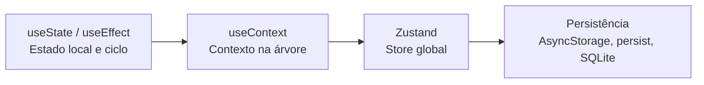
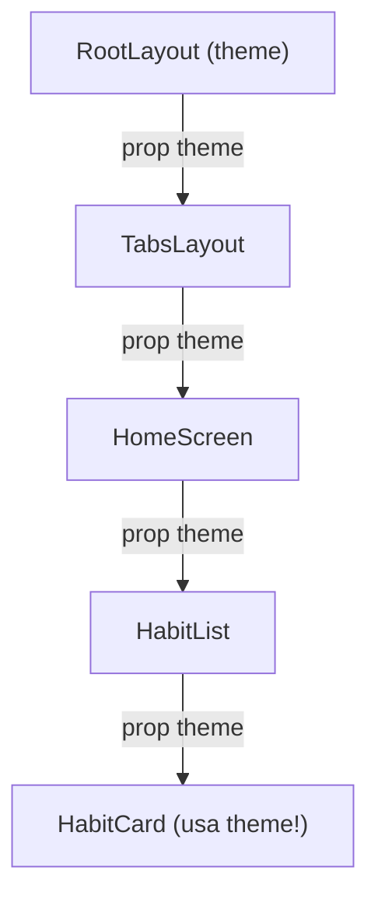
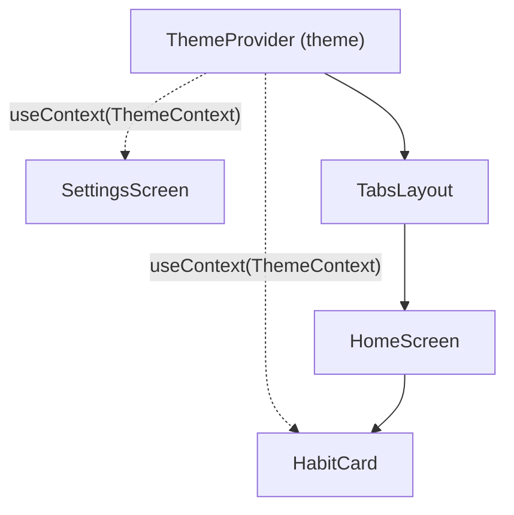

# Apresentação — Aula 8: Hooks, Estado Global com Zustand e Persistência Local

> Estrutura em Marp/Markdown. Para projetar, use o arquivo `presentation.html` (reveal.js offline).

---

## Slide 1: Abertura

# Aula 8
## Hooks, Zustand e Persistência em Disco

- Como o React guarda, sincroniza e compartilha dados
- `useState`: imutabilidade e atualização segura
- `useEffect`: ciclo de vida, timers e limpeza
- `useContext` vs. `zustand`: estado entre várias telas
- Persistência em disco: `AsyncStorage`, `persist` e `expo-sqlite`

<!-- 
Gancho: "Na Aula 7 você abriu a tela de detalhe /habit/5 e viu as abas Home e Stats. Mas quando você marcava um hábito como concluído no detalhe e voltava para a Home, a lista não sabia de nada — e se fechasse o app, perdia tudo! Hoje as telas conversam e os dados sobrevivem no disco."
-->

---

## Slide 2: O que vamos cobrir



**Tempo:** 3 horas

**Formato:** Expositivo + checkpoints + hands-on

---

## Slide 3: O problema — telas isoladas

Na Aula 7 criamos várias telas no Expo Router:

| Tela | Arquivo | O que precisa |
|---|---|---|
| Lista | `app/(tabs)/index.tsx` | Listar hábitos e marcar concluído |
| Estatísticas | `app/(tabs)/stats.tsx` | Contar total de hábitos concluídos |
| Detalhe | `app/habit/[id].tsx` | Ver, editar ou excluir um hábito |
| Configurações | `app/settings.tsx` | Alternar tema claro/escuro |

> Se cada tela tem seu próprio `useState`, elas vivem em **universos paralelos**.

---

## Slide 4: Regras dos Hooks

Antes de aprofundar, todo Hook (`use...`) segue **2 regras de ouro**:

1. **Apenas no nível superior (top level):** nunca chame dentro de `if`, `for` ou funções aninhadas.
2. **Apenas em componentes React ou custom hooks:** nunca em funções JavaScript comuns.

```tsx
// ❌ ERRADO: quebra a ordem interna dos hooks no React
if (carregou) {
  const [filtro, setFiltro] = useState('todos');
}

// ✅ CORRETO: sempre no topo do componente
const [filtro, setFiltro] = useState('todos');
```

<!-- 
Explicar que o React identifica cada hook pela ordem das chamadas em cada renderização.
-->

---

## Slide 5: useState — atualização funcional

Quando o novo estado depende do **anterior**, passe uma **função** `prev => ...`:

```tsx
const [streak, setStreak] = useState(0);

// ❌ Perigoso se chamado várias vezes seguidas (lê o mesmo valor "congelado")
const incrementarErrado = () => {
  setStreak(streak + 1);
  setStreak(streak + 1); // Resultado final: +1 em vez de +2!
};

// ✅ Seguro: recebe sempre o valor mais recente da fila
const incrementarCerto = () => {
  setStreak((prev) => prev + 1);
  setStreak((prev) => prev + 1); // Resultado final: +2
};
```

---

## Slide 6: useState — imutabilidade em arrays e objetos

O React só re-renderiza quando a **referência** muda (`novo !== antigo`). Nunca use `.push()` ou altere propriedades diretamente!

```tsx
const [habits, setHabits] = useState<Habit[]>([]);

// ✅ Adicionar: spread (...)
setHabits((prev) => [...prev, novoHabito]);

// ✅ Atualizar item: .map()
setHabits((prev) =>
  prev.map((h) => (h.id === id ? { ...h, done: !h.done } : h))
);

// ✅ Remover item: .filter()
setHabits((prev) => prev.filter((h) => h.id !== id));
```

---

## Slide 7: Checkpoint — useState

1. Por que `habits.push(novo); setHabits(habits)` não atualiza a tela?
2. Quando usar `setCount(prev => prev + 1)` em vez de `setCount(count + 1)`?
3. Posso declarar um `useState` depois de um `if (!id) return null;`?
4. Se uma tela na pilha faz `router.back()`, o que acontece com o `useState` dela?

<!-- Pausa 60 s para duplas responderem -->

---

## Slide 8: useEffect — sincronizando com o mundo externo

Um componente React deve ser uma função pura ao renderizar. Tudo que conversa com o **mundo de fora** (timers, sensores, API, notificações) vai no `useEffect`:

```tsx
useEffect(() => {
  // 1. Código do efeito (roda após a tela aparecer)
  console.log('Hábito carregado:', id);

  return () => {
    // 2. Cleanup opcional (roda antes de re-executar ou ao desmontar)
    console.log('Limpando efeito anterior');
  };
}, [id]); // 3. Array de dependências
```

---

## Slide 9: useEffect — os 3 modos do array de dependências

| Sintaxe | Quando executa | Caso de uso típico |
|---|---|---|
| `useEffect(fn)` *(sem array)* | Após **toda** renderização | Raro (debug/log) — cuidado com loop! |
| `useEffect(fn, [])` *(vazio)* | Apenas **1 vez** ao montar a tela | Registrar listener, iniciar timer |
| `useEffect(fn, [id, filtro])` | Ao montar + quando `id` ou `filtro` mudar | Buscar dados do item `id` |

---

## Slide 10: useEffect — função de limpeza (cleanup)

Lembra da "torneira aberta" dos sensores (Aula 5) e notificações (Aula 7)?

```tsx
export default function FocusTimer() {
  const [seconds, setSeconds] = useState(0);

  useEffect(() => {
    const intervalId = setInterval(() => {
      setSeconds((prev) => prev + 1);
    }, 1000);

    // Fecha a torneira quando o usuário sai da tela!
    return () => clearInterval(intervalId);
  }, []);

  return <Text>Tempo de foco: {seconds}s</Text>;
}
```

**Sem o `return () => clearInterval(...)`, o timer continua rodando em background!**

---

## Slide 11: useEffect — armadilha do loop infinito

```tsx
// ❌ LOOP INFINITO: atualiza o estado que está nas dependências
useEffect(() => {
  setHabits([...habits, novoHabito]);
}, [habits]);

// ❌ Esqueceu o [] em chamada de API: dispara dezenas de requests!
useEffect(() => {
  fetchHabits().then((data) => setHabits(data));
}); // <-- Falta o [] aqui!
```

---

## Slide 12: Checkpoint — useEffect

1. Qual a diferença entre `useEffect(fn)` e `useEffect(fn, [])`?
2. Quando a função retornada pelo `useEffect` (`cleanup`) é executada?
3. Por que usamos `setSeconds(prev => prev + 1)` dentro do `setInterval` com `[]`?

<!-- Pausa 60 s -->

---

## Slide 13: O problema do Prop Drilling

Quando vários componentes precisam do mesmo dado (ex: tema claro/escuro), passar via `props` de pai para filho vira um telefone sem fio:



**Problema:** `TabsLayout`, `HomeScreen` e `HabitList` não usam `theme`, apenas repassam!

---

## Slide 14: useContext — teletransporte na árvore

O **Context** cria um "canal direto" entre o topo da árvore (`Provider`) e qualquer componente abaixo (`useContext`):



---

## Slide 15: useContext — os 3 passos

```tsx
// src/context/theme-context.tsx
import { createContext, useContext, useState, type PropsWithChildren } from 'react';

type ThemeContextType = {
  isDark: boolean;
  toggleTheme: () => void;
};

// Passo 1: Criar o contexto
const ThemeContext = createContext<ThemeContextType | undefined>(undefined);

// Passo 2: Criar o Provider
export function ThemeProvider({ children }: PropsWithChildren) {
  const [isDark, setIsDark] = useState(false);
  const toggleTheme = () => setIsDark((prev) => !prev);

  return (
    <ThemeContext.Provider value={{ isDark, toggleTheme }}>
      {children}
    </ThemeContext.Provider>
  );
}

// Passo 3: Hook customizado para consumir com segurança
export function useTheme() {
  const context = useContext(ThemeContext);
  if (!context) throw new Error('useTheme deve ser usado dentro de ThemeProvider');
  return context;
}
```

---

## Slide 16: useContext — plugando no Expo Router

Envolva o navegador no `src/app/_layout.tsx`:

```tsx
// src/app/_layout.tsx
import { Stack } from 'expo-router';
import { ThemeProvider } from '@/context/theme-context';

export default function RootLayout() {
  return (
    <ThemeProvider>
      <Stack />
    </ThemeProvider>
  );
}

// Em qualquer tela (ex: src/app/settings.tsx):
const { isDark, toggleTheme } = useTheme();
```

---

## Slide 17: Limite do useContext e Checkpoint

**Por que não usar `useContext` para tudo?**
- Quando o `value` do `Provider` muda, **todos** os componentes que chamam `useContext` naquele contexto re-renderizam.
- Se você tiver 5 contexts (Auth, Theme, Habits, Filters, Notifications), vira o **"Provider Hell"** no `_layout.tsx`.

**Checkpoint:**
1. Quais são os 3 passos para criar e usar um Context?
2. Por que criamos o hook `useTheme()` em vez de exportar `ThemeContext` direto?
3. Para que tipo de dado `useContext` brilha? (Ex: tema, idioma, usuário logado).

<!-- Pausa 45 s -->

---

## Slide 18: Zustand — estado global sem cerimônia

**Zustand** ("estado" em alemão) é uma biblioteca minimalista de gerenciamento de estado global para React / React Native:

- **Sem `<Provider>`:** a store vive fora da árvore de componentes.
- **Renderização cirúrgica:** componentes assinam apenas a fatia do estado que usam (via **seletores**).
- **Estado + Ações juntos:** tudo em um único hook tipado.

```bash
npm install zustand
```

---

## Slide 19: Zustand — criando a Store

```tsx
// src/store/use-habit-store.ts
import { create } from 'zustand';

export type Habit = {
  id: string;
  title: string;
  done: boolean;
};

type HabitStore = {
  habits: Habit[];
  addHabit: (title: string) => void;
  toggleHabit: (id: string) => void;
  removeHabit: (id: string) => void;
};

export const useHabitStore = create<HabitStore>((set) => ({
  habits: [
    { id: '1', title: 'Beber 2L de água', done: false },
    { id: '2', title: 'Ler 15 páginas', done: true },
  ],
  addHabit: (title) =>
    set((state) => ({
      habits: [...state.habits, { id: Date.now().toString(), title, done: false }],
    })),
  toggleHabit: (id) =>
    set((state) => ({
      habits: state.habits.map((h) => (h.id === id ? { ...h, done: !h.done } : h)),
    })),
  removeHabit: (id) =>
    set((state) => ({
      habits: state.habits.filter((h) => h.id !== id),
    })),
}));
```

---

## Slide 20: Zustand — consumindo com Seletores

Use um **seletor** `(state) => state.algo` para pegar apenas o que o componente precisa:

```tsx
// src/app/(tabs)/index.tsx
import { useHabitStore } from '@/store/use-habit-store';

export default function HomeScreen() {
  // Só re-renderiza quando 'habits' mudar!
  const habits = useHabitStore((state) => state.habits);
  const toggleHabit = useHabitStore((state) => state.toggleHabit);

  return (
    <FlatList
      data={habits}
      keyExtractor={(item) => item.id}
      renderItem={({ item }) => (
        <Pressable onPress={() => toggleHabit(item.id)}>
          <Text>{item.done ? '✅' : '⬜'} {item.title}</Text>
        </Pressable>
      )}
    />
  );
}
```

---

## Slide 21: Zustand — sincronizando várias telas

Agora a aba de Estatísticas e a tela de Detalhe leem da **mesma fonte da verdade**:

```tsx
// src/app/(tabs)/stats.tsx
export default function StatsScreen() {
  const habits = useHabitStore((state) => state.habits);
  const doneCount = habits.filter((h) => h.done).length;

  return <Text>Concluídos: {doneCount} de {habits.length}</Text>;
}

// src/app/habit/[id].tsx
export default function HabitDetailScreen() {
  const { id } = useLocalSearchParams<{ id: string }>();
  const habit = useHabitStore((state) => state.habits.find((h) => h.id === id));
  const toggleHabit = useHabitStore((state) => state.toggleHabit);

  if (!habit) return <Text>Hábito não encontrado</Text>;
  return (
    <Pressable onPress={() => toggleHabit(habit.id)}>
      <Text>{habit.title} — {habit.done ? 'Concluído' : 'Pendente'}</Text>
    </Pressable>
  );
}
```

---

## Slide 22: useState vs. useContext vs. Zustand

| Critério | `useState` | `useContext` | `zustand` |
|---|---|---|---|
| **Escopo** | Local (1 componente) | Subárvore do `Provider` | Global (todo o app) |
| **Precisa de Provider?** | Não | Sim | **Não** |
| **Re-renderização** | O componente e filhos | Todos que consomem o contexto | Só quem selecionou o dado alterado |
| **Melhor para** | Inputs, modais, toggles locais | Tema, idioma, sessão de auth | Dados de domínio (hábitos, carrinho) |

---

## Slide 23: Checkpoint — Zustand

1. Preciso adicionar algum `<Provider>` no `_layout.tsx` para usar o Zustand?
2. Qual a diferença entre `const { habits } = useHabitStore()` e `const habits = useHabitStore(s => s.habits)`?
3. O que a função `set((state) => ...)` faz dentro do `create`?
4. Se o app for fechado e reaberto agora, os dados do Zustand continuam lá?

<!-- Pausa 45 s. Na 4: Não! Por padrão o Zustand guarda em memória RAM; vamos resolver isso agora na Parte 5 com persistência em disco! -->

---

## Slide 24: Persistência local em disco — memória RAM vs. disco

Até aqui, `useState`, `useContext` e `zustand` guardam dados na **memória RAM**:
- Fechou o app ou reiniciou o celular → **tudo volta ao estado inicial**.
- Para salvar no **disco do aparelho**, temos 3 ferramentas principais no ecossistema Expo:

1. **`AsyncStorage`**: armazenamento chave-valor assíncrono (como o `localStorage` da web).
2. **Middleware `persist` do Zustand**: conecta a store do Zustand direto ao `AsyncStorage`.
3. **`expo-sqlite`**: banco de dados relacional SQL completo para grandes volumes e consultas complexas.

---

## Slide 25: `AsyncStorage` — chave e valor em JSON

```bash
npx expo install @react-native-async-storage/async-storage
```

`AsyncStorage` guarda apenas **strings**. Para salvar objetos ou arrays, usamos `JSON.stringify` e `JSON.parse`:

```tsx
import AsyncStorage from '@react-native-async-storage/async-storage';

// Salvar no disco
async function salvarTema(isDark: boolean) {
  await AsyncStorage.setItem('@habits:theme', JSON.stringify(isDark));
}

// Ler do disco (ex: dentro de um useEffect(..., []))
async function carregarTema(): Promise<boolean> {
  const salvo = await AsyncStorage.getItem('@habits:theme');
  return salvo ? JSON.parse(salvo) : false;
}
```

---

## Slide 26: Zustand `persist` — salvando a store automaticamente

Em vez de chamar `AsyncStorage.setItem` manualmente em cada ação, o middleware **`persist`** salva e hidrata a store sozinho:

```tsx
// src/store/use-habit-store.ts
import AsyncStorage from '@react-native-async-storage/async-storage';
import { create } from 'zustand';
import { createJSONStorage, persist } from 'zustand/middleware';

export const useHabitStore = create<HabitStore>()(
  persist(
    (set) => ({
      habits: [],
      addHabit: (title) =>
        set((state) => ({
          habits: [...state.habits, { id: Date.now().toString(), title, done: false }],
        })),
      toggleHabit: (id) =>
        set((state) => ({
          habits: state.habits.map((h) => (h.id === id ? { ...h, done: !h.done } : h)),
        })),
      removeHabit: (id) =>
        set((state) => ({
          habits: state.habits.filter((h) => h.id !== id),
        })),
    }),
    {
      name: '@habits:store', // Chave única no AsyncStorage
      storage: createJSONStorage(() => AsyncStorage),
    }
  )
);
```

> **Detalhe do TypeScript:** note os parênteses duplos `create<HabitStore>()(persist(...))`.

---

## Slide 27: `expo-sqlite` — banco relacional no aparelho

Quando você tem milhares de registros, relacionamentos ou buscas com `WHERE` / `ORDER BY`, regravar um JSON inteiro no `AsyncStorage` fica lento. Entra o **`expo-sqlite`**:

```bash
npx expo install expo-sqlite
```

```tsx
import * as SQLite from 'expo-sqlite';

const db = await SQLite.openDatabaseAsync('habits.db');

// 1. Criar tabela
await db.execAsync(`
  CREATE TABLE IF NOT EXISTS habits (
    id INTEGER PRIMARY KEY AUTOINCREMENT,
    title TEXT NOT NULL,
    done INTEGER DEFAULT 0
  );
`);

// 2. Inserir com parâmetros seguros (?)
await db.runAsync('INSERT INTO habits (title, done) VALUES (?, ?)', 'Beber água', 0);

// 3. Consultar registros tipados
const todos = await db.getAllAsync<{ id: number; title: string; done: number }>(
  'SELECT * FROM habits WHERE done = ? ORDER BY id DESC',
  0
);
```

---

## Slide 28: `AsyncStorage` + `persist` vs. `expo-sqlite`

| Critério | `AsyncStorage` | Zustand `persist` + `AsyncStorage` | `expo-sqlite` |
|---|---|---|---|
| **Modelo** | Chave-valor (`string`) | Store reativa espelhada em JSON | Tabelas relacionais (SQL) |
| **Código manual** | `getItem` / `setItem` + `JSON` | Automático a cada `set()` | Queries SQL (`runAsync`, `getAllAsync`) |
| **Volume ideal** | Pequeno (flags, preferências) | Pequeno a médio (dezenas/centenas de itens) | Médio a grande (milhares de linhas) |
| **Buscas e filtros** |Em memória (JS `.filter()`) | Em memória (JS `.filter()`) | Índices e SQL (`WHERE`, `JOIN`) |

---

## Slide 29: Checkpoint — Persistência em disco

1. Por que precisamos de `JSON.stringify` e `JSON.parse` ao usar `AsyncStorage` diretamente?
2. O que o `createJSONStorage(() => AsyncStorage)` faz junto com o middleware `persist` do Zustand?
3. Quando vale a pena trocar o `AsyncStorage` pelo `expo-sqlite`?
4. Qual a diferença entre `db.runAsync(...)` e `db.getAllAsync(...)` no `expo-sqlite`?

<!-- Pausa 45 s -->

---

## Slide 30: Resumo — Arquitetura Completa na Aula 8

```mermaid
flowchart TB
  subgraph Disco["Disco do Aparelho"]
    AS["AsyncStorage / SQLite"]
  end
  subgraph Store["Zustand Store + persist"]
    S["habits[]<br/>addHabit / toggleHabit / removeHabit"]
  end
  subgraph Context["ThemeContext (_layout.tsx)"]
    T["isDark / toggleTheme"]
  end
  S <-->|"createJSONStorage"| AS
  H["(tabs)/index.tsx<br/>useState (input)<br/>useHabitStore"] <--> S
  ST["(tabs)/stats.tsx<br/>useHabitStore"] <-- S
  D["habit/[id].tsx<br/>useEffect (timer)<br/>useHabitStore"] <--> S
  T -.-> H
  T -.-> ST
  T -.-> D
```

---

## Slide 31: Próximos passos (não é aula)

- Consumo de APIs REST e estado de servidor (`fetch`, TanStack Query)
- Sincronização offline-first (banco local + nuvem)
- Hooks de otimização de performance (`useMemo`, `useCallback`, `useRef`)

---

## Slide 32: Fechamento

✅ **`useState`** — estado local, atualização funcional (`prev => ...`) e imutabilidade

✅ **`useEffect`** — sincronização com timers/listeners e limpeza no `return`

✅ **`useContext`** — compartilhamento de tema/configurações sem prop drilling

✅ **`zustand`** — store global reativa, com seletores e sem `Provider`

✅ **Persistência local** — `AsyncStorage`, middleware `persist` e `expo-sqlite`

🚀 **Suas telas conversam entre si e os dados sobrevivem no disco!**

---
