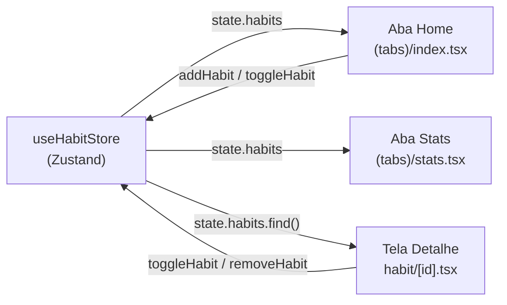

# Notas para estudo — Aula 8: Hooks, Estado Global com Zustand e Persistência Local

> ⚠️ **Escopo desta aula:** aprofundamento nos hooks fundamentais do React (`useState`, `useEffect`, `useContext`), gerenciamento de estado global entre telas com `zustand` e persistência local em disco (`AsyncStorage`, middleware `persist` do Zustand e `expo-sqlite`). Chamadas a APIs remotas e sincronização com servidor ficam para as próximas aulas.

---

## 1. `useState` — Estado local e imutabilidade

### O que você já usava (e o que falta dominar)

Desde a Aula 3, usamos `useState` para guardar valores que mudam na tela (o texto de um `TextInput`, um `Switch` ligado/desligado). Na prática, porém, dois erros derrubam aplicativos reais: **mutação direta de arrays/objetos** e **atualização com valor defasado (stale state)**.

### As 2 Regras de Ouro dos Hooks

Todo Hook em React começa com `use` (`useState`, `useEffect`, `useContext`, `useLocalSearchParams`, `useHabitStore`) e deve respeitar duas regras:

1. **Chame Hooks apenas no nível superior (top level):** nunca coloque um Hook dentro de `if`, `else`, `for`, `while` ou funções internas. Se você precisa de um `return` antecipado (ex: `if (!habit) return null;`), declare **todos os hooks antes** desse `if`.
2. **Chame Hooks apenas dentro de componentes React ou Custom Hooks:** não chame hooks em funções utilitárias comuns fora do ciclo do React.

### Atualização funcional (`prev => ...`)

Quando o próximo estado depende do valor anterior, passe uma **função atualizadora**:

```tsx
const [count, setCount] = useState(0);

// ❌ Problema: lê o mesmo valor 'count' da renderização atual
function somarDoisErrado() {
  setCount(count + 1);
  setCount(count + 1); // Soma apenas +1!
}

// ✅ Correto: o React entrega o estado mais recente em 'prev'
function somarDoisCerto() {
  setCount((prev) => prev + 1);
  setCount((prev) => prev + 1); // Soma +2!
}
```

### Imutabilidade em Arrays e Objetos

O React decide se deve atualizar a tela comparando a referência antiga com a nova (`Object.is(antigo, novo)`). Se você usar `habits.push(novo)` e chamar `setHabits(habits)`, o endereço de memória do array **continua o mesmo** e a tela **não atualiza**.

| Operação | ❌ Mutação (Não funciona) | ✅ Imutável (Cria nova referência) |
|---|---|---|
| **Adicionar** | `habits.push(novo)` | `setHabits((prev) => [...prev, novo])` |
| **Remover** | `habits.splice(idx, 1)` | `setHabits((prev) => prev.filter((h) => h.id !== id))` |
| **Alterar item** | `habits[0].done = true` | `setHabits((prev) => prev.map((h) => h.id === id ? { ...h, done: !h.done } : h))` |
| **Alterar objeto** | `user.name = 'Ana'` | `setUser((prev) => ({ ...prev, name: 'Ana' }))` |

---

## 2. `useEffect` — Ciclo de vida e efeitos colaterais

### Quando usar `useEffect`

A função do seu componente deve apenas calcular a interface a partir das `props` e do `state`. Qualquer interação com o **mundo exterior** ao componente é um **efeito colateral (side effect)**:

- Iniciar um cronômetro (`setInterval`, `setTimeout`)
- Registrar listeners de sensores (Aula 5) ou notificações (Aula 7)
- Carregar dados quando o parâmetro `[id]` da rota muda

### Estrutura completa do `useEffect`

```tsx
import { useEffect, useState } from 'react';
import { Text, View } from 'react-native';

export default function FocusTimerScreen() {
  const [seconds, setSeconds] = useState(0);
  const [isRunning, setIsRunning] = useState(true);

  useEffect(() => {
    if (!isRunning) return;

    // 1. Efeito: inicia o cronômetro
    const timer = setInterval(() => {
      setSeconds((prev) => prev + 1);
    }, 1000);

    // 2. Cleanup (limpeza): roda ao desmontar a tela ou quando 'isRunning' muda
    return () => {
      clearInterval(timer);
    };
  }, [isRunning]); // 3. Array de dependências

  return (
    <View>
      <Text>Tempo focado: {seconds}s</Text>
    </View>
  );
}
```

### Os 3 comportamentos do array de dependências

| Dependências | Quando o efeito roda | Quando o cleanup roda |
|---|---|---|
| `useEffect(fn)` *(sem array)* | Após **toda** renderização | Antes de cada nova renderização e ao desmontar |
| `useEffect(fn, [])` *(array vazio)* | **Uma única vez**, quando o componente monta | Apenas quando o componente desmonta (sai da pilha) |
| `useEffect(fn, [a, b])` | Ao montar + sempre que `a` ou `b` mudarem | Antes de re-executar o efeito e ao desmontar |

> 💡 **Quando NÃO usar `useEffect`:** se você quer calcular um valor derivado de outro estado (ex: contar quantos hábitos estão concluídos a partir de `habits`), **não** crie um segundo `useState` + `useEffect`. Calcule direto no corpo do componente:
> ```tsx
> const completedCount = habits.filter((h) => h.done).length;
> ```

---

## 3. `useContext` — Compartilhando estado na árvore

### O problema do Prop Drilling

Imagine que o estado `isDark` (tema escuro) está no `_layout.tsx` raiz e um componente `<HabitCard>` (4 níveis abaixo) precisa dele. Passar `isDark` como prop por 4 componentes intermediários que nem usam essa informação é chamado de **Prop Drilling**.

### A solução em 3 passos com `useContext`

```tsx
// src/context/theme-context.tsx
import { createContext, useContext, useState, type PropsWithChildren } from 'react';

type ThemeContextData = {
  isDark: boolean;
  toggleTheme: () => void;
  colors: {
    background: string;
    text: string;
    card: string;
    primary: string;
  };
};

// 1. Criar o Contexto
const ThemeContext = createContext<ThemeContextData | undefined>(undefined);

// 2. Criar o Provider que guarda o estado e fornece o valor
export function ThemeProvider({ children }: PropsWithChildren) {
  const [isDark, setIsDark] = useState(false);

  const toggleTheme = () => setIsDark((prev) => !prev);

  const colors = isDark
    ? { background: '#121212', text: '#F5F5F5', card: '#1E1E1E', primary: '#FF6002' }
    : { background: '#FEF7EE', text: '#191919', card: '#FFFFFF', primary: '#FF6002' };

  return (
    <ThemeContext.Provider value={{ isDark, toggleTheme, colors }}>
      {children}
    </ThemeContext.Provider>
  );
}

// 3. Criar um custom hook para consumir com verificação de erro
export function useTheme() {
  const context = useContext(ThemeContext);
  if (!context) {
    throw new Error('useTheme deve ser usado dentro de um <ThemeProvider>');
  }
  return context;
}
```

### Usando com Expo Router

Coloque o `<ThemeProvider>` no `src/app/_layout.tsx` envolvendo o navegador (`<Stack>` ou `<Drawer>`). Assim, todas as telas do app conseguem chamar `const { colors, toggleTheme } = useTheme()`.

### O limite do `useContext`

Toda vez que qualquer valor dentro do `ThemeContext.Provider` muda, **todos os componentes que chamam `useTheme()` re-renderizam**, mesmo que só usem uma parte do objeto. Por isso:
- **Use `useContext` para:** estados globais de **baixa frequência** de mudança (Tema claro/escuro, Idioma, Usuário autenticado).
- **Evite `useContext` para:** listas grandes e dados de domínio que mudam a todo instante (lista de hábitos, carrinho de compras, cronômetros).

---

## 4. Estado global com `zustand`

### Por que `zustand`?

Para compartilhar os hábitos entre a lista (`(tabs)/index.tsx`), a tela de estatísticas (`(tabs)/stats.tsx`) e a tela de detalhe (`habit/[id].tsx`), precisamos de uma **store global**. O **Zustand** resolve isso com:

1. **Zero boilerplate:** não precisa envolver o app em `<Provider>`.
2. **Seletores cirúrgicos:** cada componente assina apenas a propriedade que usa.
3. **API simples e tipada:** uma função `create<T>((set) => ({ ... }))`.

### Instalação

```bash
npm install zustand
```

### Criando a Store de Hábitos

```tsx
// src/store/use-habit-store.ts
import { create } from 'zustand';

export type Habit = {
  id: string;
  title: string;
  category: string;
  done: boolean;
  streak: number;
};

type HabitStore = {
  habits: Habit[];
  addHabit: (title: string, category: string) => void;
  toggleHabit: (id: string) => void;
  removeHabit: (id: string) => void;
};

export const useHabitStore = create<HabitStore>((set) => ({
  habits: [
    { id: '1', title: 'Beber 2L de água', category: 'Saúde', done: false, streak: 3 },
    { id: '2', title: 'Ler 15 páginas', category: 'Estudo', done: true, streak: 7 },
    { id: '3', title: 'Alongar 10 min', category: 'Corpo', done: false, streak: 1 },
  ],

  addHabit: (title, category) =>
    set((state) => ({
      habits: [
        ...state.habits,
        {
          id: Date.now().toString(),
          title: title.trim(),
          category,
          done: false,
          streak: 0,
        },
      ],
    })),

  toggleHabit: (id) =>
    set((state) => ({
      habits: state.habits.map((habit) =>
        habit.id === id
          ? {
              ...habit,
              done: !habit.done,
              streak: !habit.done ? habit.streak + 1 : Math.max(0, habit.streak - 1),
            }
          : habit
      ),
    })),

  removeHabit: (id) =>
    set((state) => ({
      habits: state.habits.filter((habit) => habit.id !== id),
    })),
}));
```

### Consumindo a Store com Seletores

**Regra de ouro no Zustand:** sempre passe um seletor `(state) => state.propriedade` para evitar que o componente re-renderize quando outra parte da store mudar.

```tsx
// ✅ BOM: seleciona apenas o que usa
const habits = useHabitStore((state) => state.habits);
const toggleHabit = useHabitStore((state) => state.toggleHabit);

// ⚠️ EVITE: assina a store inteira (re-renderiza em qualquer mudança)
const { habits, toggleHabit } = useHabitStore();
```



---

## 5. Persistência local em disco (`AsyncStorage`, `persist` e `expo-sqlite`)

### Memória RAM vs. Disco do Aparelho

Por padrão, tanto os hooks do React (`useState`, `useContext`) quanto a store do `zustand` guardam dados na **memória RAM**. Quando o usuário fecha o app ou o sistema operacional encerra o processo em segundo plano, a memória RAM é limpa. Para que os dados sobrevivam entre sessões, precisamos gravá-los no **armazenamento local (disco)** do dispositivo.

### 5.1. `AsyncStorage` — Dicionário chave-valor assíncrono

O `@react-native-async-storage/async-storage` é o equivalente mobile do `localStorage` da web, porém **assíncrono** (retorna `Promise`) e armazena apenas `string`.

```bash
npx expo install @react-native-async-storage/async-storage
```

```tsx
import AsyncStorage from '@react-native-async-storage/async-storage';

const THEME_KEY = '@habits:isDark';

// Gravar no disco (serializando para JSON)
export async function saveThemePreference(isDark: boolean) {
  await AsyncStorage.setItem(THEME_KEY, JSON.stringify(isDark));
}

// Ler do disco (convertendo de volta com JSON.parse)
export async function loadThemePreference(): Promise<boolean> {
  const raw = await AsyncStorage.getItem(THEME_KEY);
  return raw !== null ? JSON.parse(raw) : false;
}

// Remover uma chave específica
export async function clearThemePreference() {
  await AsyncStorage.removeItem(THEME_KEY);
}
```

### 5.2. Middleware `persist` do Zustand + `AsyncStorage`

Chamar `AsyncStorage.setItem` manualmente após cada alteração na store seria repetitivo e propenso a erros. O Zustand traz o middleware **`persist`** que:

1. **Salva automaticamente** o estado no `AsyncStorage` sempre que `set()` é chamado.
2. **Hidrata (recarrega)** o estado salvo automaticamente quando o app abre.

```tsx
// src/store/use-habit-store.ts
import AsyncStorage from '@react-native-async-storage/async-storage';
import { create } from 'zustand';
import { createJSONStorage, persist } from 'zustand/middleware';

export type Habit = {
  id: string;
  title: string;
  done: boolean;
};

type HabitStore = {
  habits: Habit[];
  addHabit: (title: string) => void;
  toggleHabit: (id: string) => void;
  removeHabit: (id: string) => void;
};

// Note o duplo parêntese create<HabitStore>()(...) exigido pelo TypeScript ao usar middlewares
export const useHabitStore = create<HabitStore>()(
  persist(
    (set) => ({
      habits: [
        { id: '1', title: 'Beber 2L de água', done: false },
        { id: '2', title: 'Ler 15 páginas', done: true },
      ],
      addHabit: (title) =>
        set((state) => ({
          habits: [
            ...state.habits,
            { id: Date.now().toString(), title: title.trim(), done: false },
          ],
        })),
      toggleHabit: (id) =>
        set((state) => ({
          habits: state.habits.map((h) =>
            h.id === id ? { ...h, done: !h.done } : h
          ),
        })),
      removeHabit: (id) =>
        set((state) => ({
          habits: state.habits.filter((h) => h.id !== id),
        })),
    }),
    {
      name: '@habits:store-v1', // Nome da chave gravada no AsyncStorage
      storage: createJSONStorage(() => AsyncStorage),
    }
  )
);
```

### 5.3. `expo-sqlite` — Banco de dados relacional SQL no celular

Quando o app cresce para milhares de registros (ex: histórico diário de hábitos ao longo de anos, filtros por data/categoria, `JOIN` entre tabelas), serializar tudo em um único JSON no `AsyncStorage` perde performance. Para dados estruturados e consultas relacionais, usamos o **`expo-sqlite`**:

```bash
npx expo install expo-sqlite
```

```tsx
import * as SQLite from 'expo-sqlite';

export type HabitRow = {
  id: number;
  title: string;
  done: number; // SQLite usa 0 (false) e 1 (true) para booleanos
};

export async function initDatabase() {
  const db = await SQLite.openDatabaseAsync('habits.db');

  // execAsync: ideal para comandos DDL (CREATE TABLE, PRAGMA)
  await db.execAsync(`
    PRAGMA journal_mode = WAL;
    CREATE TABLE IF NOT EXISTS habits (
      id INTEGER PRIMARY KEY AUTOINCREMENT,
      title TEXT NOT NULL,
      done INTEGER NOT NULL DEFAULT 0
    );
  `);

  return db;
}

export async function insertHabitSql(db: SQLite.SQLiteDatabase, title: string) {
  // runAsync: para INSERT, UPDATE, DELETE com placeholders '?' contra SQL Injection
  const result = await db.runAsync(
    'INSERT INTO habits (title, done) VALUES (?, ?)',
    title,
    0
  );
  return result.lastInsertRowId;
}

export async function getAllHabitsSql(db: SQLite.SQLiteDatabase): Promise<HabitRow[]> {
  // getAllAsync: retorna todas as linhas da consulta já tipadas
  return db.getAllAsync<HabitRow>('SELECT * FROM habits ORDER BY id DESC');
}
```

---

## Tabela de comparação: quando usar o quê

| Cenário | Ferramenta ideal | Motivo |
|---|---|---|
| Texto digitado em um `TextInput` antes de salvar | `useState` | Só importa para o formulário daquela tela |
| Modal aberto/fechado ou aba de filtro local | `useState` | Estado efêmero de um único componente |
| Cronômetro de foco que precisa parar ao sair da tela | `useState` + `useEffect` | Precisa de `setInterval` e cleanup no `return` |
| Tema Claro/Escuro ou Idioma do app | `useContext` + `AsyncStorage` | Muda raramente e afeta o visual de toda a árvore |
| Lista de hábitos compartilhada entre telas e salva no aparelho | `zustand` + `persist` (`AsyncStorage`) | Sincroniza rotas automaticamente e persiste em JSON sem código manual |
| Histórico com milhares de registros, buscas `WHERE` e relatórios SQL | `expo-sqlite` | Banco relacional com índices e consultas parciais sem carregar tudo na RAM |

---

## Erros comuns

| Erro | Causa | Correção |
|---|---|---|
| Adicionar item ao array e a tela não atualizar | Uso de `habits.push()` (mutação direta) | Usar `setHabits(prev => [...prev, novo])` |
| Cronômetro acelera ou continua rodando após voltar | Faltou função de limpeza no `useEffect` | Retornar `() => clearInterval(id)` no `useEffect` |
| `Rendered more hooks than during the previous render` | Hook chamado dentro de `if` ou depois de um `return` | Mover todos os Hooks para o topo do componente |
| `useTheme` retorna `undefined` | Tela fora do `<ThemeProvider>` | Colocar `<ThemeProvider>` no `src/app/_layout.tsx` |
| Mudança no detalhe `/habit/5` não reflete na Home | Cada tela criou seu próprio `useState` local | Mover a lista de hábitos para a store do `zustand` |
| Erro de tipo no `create<HabitStore>(persist(...))` | Faltou invocar o currying `create<T>()(...)` | Usar `create<HabitStore>()(persist(...))` |
| `AsyncStorage.setItem` falha com objeto | `AsyncStorage` só aceita `string` | Converter antes com `JSON.stringify(obj)` |

---

## Verificação rápida: você aprendeu?

- [ ] Sei atualizar um array em `useState` sem usar `.push()` ou `.splice()`?
- [ ] Sei quando usar `setState(prev => ...)` em vez de passar o valor direto?
- [ ] Consigo explicar os 3 modos do `useEffect` (sem array, `[]`, `[dep]`)?
- [ ] Sei limpar timers e listeners com `return () => ...` dentro do `useEffect`?
- [ ] Consigo criar um Context com `createContext`, `Provider` e custom hook?
- [ ] Sei criar uma store no `zustand` com estado e ações imutáveis?
- [ ] Consigo persistir a store do Zustand no `AsyncStorage` usando `persist` e `createJSONStorage`?
- [ ] Sei explicar quando usar `AsyncStorage` + `persist` e quando usar `expo-sqlite`?

---

## Para saber mais

- [React Docs — Gerenciando Estado](https://pt-br.react.dev/learn/managing-state)
- [React Docs — Sincronizando com Efeitos (`useEffect`)](https://pt-br.react.dev/learn/synchronizing-with-effects)
- [React Docs — Passando Dados Profundamente com Contexto](https://pt-br.react.dev/learn/passing-data-deeply-with-context)
- [Zustand — Documentação Oficial](https://zustand.docs.pmnd.rs/getting-started/introduction)
- [Zustand — Middleware `persist`](https://zustand.docs.pmnd.rs/integrations/persisting-store-data)
- [Expo Docs — `AsyncStorage`](https://docs.expo.dev/versions/latest/sdk/async-storage/)
- [Expo Docs — `expo-sqlite`](https://docs.expo.dev/versions/latest/sdk/sqlite/)
